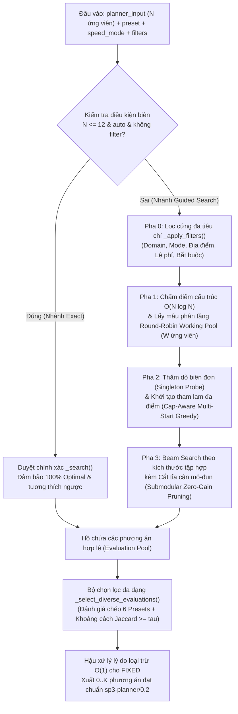

# Báo Cáo Kỹ Thuật: Thuật Toán Lập Lịch Đa Tiêu Chí & Tối Ưu Hóa Tổ Hợp SP3

> [!IMPORTANT]
> Báo cáo này tổng hợp mô hình toán học, các công thức cốt lõi, kiến trúc giải thuật Heuristic 3 pha và phân tích độ phức tạp tính toán của bộ máy lập lịch SP3 được triển khai tại `src/sp3/planner.py` và `src/sp3/scheduler.py` trên nhánh `schedule-optimization`.
> Xem thêm tài liệu giải thích ký hiệu toán học dành cho người mới bắt đầu tại [SP3_MATH_GLOSSARY.md](./SP3_MATH_GLOSSARY.md).

---

## 1. Mô Hình Hóa Toán Học & Bản Chất Độ Phức Tạp (NP-Hardness)

### 1.1. Phát biểu bài toán hình thức

Cho tập ứng viên gồm $N$ hoạt động khả thi $\mathcal{C} = \{a_1, a_2, \dots, a_N\}$. Mỗi hoạt động $a_i \in \mathcal{C}$ có bộ thuộc tính:
- **Thời lượng kế hoạch**: $d_i > 0$ (phút).
- **Lịch trình**: $s_i \in \{\text{FIXED}, \text{FLEXIBLE\_WINDOW}\}$ nằm trong tập khoảng thời gian rảnh của sinh viên $\mathcal{A} = \{[t_1^{\text{start}}, t_1^{\text{end}}), \dots, [t_m^{\text{start}}, t_m^{\text{end}})\}$.
- **Thuộc tính đa tiêu chí**: lĩnh vực $\text{dom}(a_i)$, hình thức $\text{mode}(a_i) \in \{\text{online}, \text{offline}, \text{hybrid}\}$, địa điểm $\text{loc}(a_i)$, lệ phí $\text{fee}(a_i) \ge 0$, cờ bắt buộc $\text{mand}(a_i) \in \{0, 1\}$, và mã ràng buộc quy tắc $\text{ref}(a_i)$.

Gọi $K \subseteq \mathcal{C}$ là tập hoạt động bắt buộc giữ nguyên từ kế hoạch trước (`keep_requests`), và $E = \{e_{ij}\}$ là tập các cặp xung đột thời gian cố định (`conflict_pairs`). Một phương án lập lịch $S \subseteq \mathcal{C}$ là **hợp lệ (valid subset)** khi và chỉ khi thỏa mãn đồng thời 4 ràng buộc cứng:

- **(C1) Giữ lịch cố định (`keep_requests`):**
  $$K \subseteq S$$
- **(C2) Không xung đột cặp (`conflict_pairs`):**
  $$\forall u, v \in S, \quad \{u, v\} \notin E$$
- **(C3) Giới hạn số lượng và tổng thời lượng (`limits`):**
  $$|S| \le M_{\max} \quad \land \quad D(S) = \sum_{a_i \in S} d_i \le T_{\max} + \varepsilon$$
- **(C4) Khả năng xếp lịch toàn cục (`scheduler`):**
  $$\operatorname{schedule\_set}(S, \mathcal{A}) = \operatorname{SCHEDULED}$$

trong đó $\varepsilon = 10^{-9}$ là dung sai số thực chuẩn theo hợp đồng `sp3-planner/0.2` (`src/sp3/contract.py`).

### 1.2. Tại sao bài toán là NP-Hard ở cả hai tầng?

Bài toán lập lịch SP3 là sự kết hợp của **2 bài toán NP-Hard kinh điển**:

1. **Tầng 1 — Xếp lịch khung giờ linh hoạt (`src/sp3/scheduler.py`)**:
   - Với một tập con $S$ có $k$ hoạt động dạng `FLEXIBLE_WINDOW`, mỗi hoạt động $i$ cần một khoảng thời gian liên tục độ dài $d_i$ nằm hoàn toàn trong cửa sổ khả dụng $[r_i, \text{dl}_i]$ và nằm trọn trong một khoảng rảnh thuộc $\mathcal{A}$ sao cho không có hai hoạt động nào giao nhau.
   - Đây chính là bài toán **Non-Preemptive Single-Machine Scheduling with Release Times and Deadlines ($1 \mid r_j, \text{dl}_j \mid -$)** — một bài toán **NP-Complete mạnh (Strongly NP-Complete)** (Garey & Johnson, 1979).

2. **Tầng 2 — Chọn tập con tối ưu với hàm điểm phi tuyến có trần (`src/sp3/planner.py`)**:
   - Điểm rèn luyện của một tập $S$ được tính qua hàm hộp đen $F_{\text{SP2}}(S)$ từ bộ quy tắc DRL: điểm mỗi mục $c \in \mathcal{M} = \{C_1, \dots, C_5\}$ bị chặn trên bởi trần mục $\text{Cap}_c$, một số quy tắc có giới hạn số lần cộng hoặc phụ thuộc thứ tự thời gian (`attribution_order`).
   - Do $F_{\text{SP2}}(S)$ là hàm **cận mô-đun đơn điệu (Monotone Submodular Function)** chịu ràng buộc đồ thị xung đột (Independent Set) và ràng buộc túi ba lô hai chiều (số lượng $M_{\max}$, thời lượng $T_{\max}$), bài toán tổng quát quy về **Submodular Maximization / Multi-Criteria Set Cover with Disjunctive Conflict Constraints**, thuộc lớp **NP-Hard**.

---

## 2. Kiến Trúc Tổng Thể Của Giải Thuật Đề Xuất

Để giải quyết sự bùng nổ tổ hợp khi $N$ tăng lên hàng trăm hoạt động ($N = 100 \dots 500+$) mà vẫn giữ nguyên tính chính xác tuyệt đối khi $N$ nhỏ, giải thuật được thiết kế theo mô hình **Hybrid Adaptive Pipeline**:

---

## 3. Hệ Thống Công Thức Toán Học Cốt Lõi

### 3.1. Các đại lượng điểm số và độ thiếu hụt (Target Gaps)

Với một tập hoạt động được chọn $S \subseteq \mathcal{C}$ và lịch xếp tương ứng $\sigma = \text{schedule\_set}(S)$, bộ chấm điểm SP2 trả về điểm dự kiến sau khi cộng của từng mục $A_c(S)$ và tổng điểm dự kiến $A_{\text{tot}}(S)$.

- **Độ thiếu hụt từng mục (Category Gap)**:
  $$G_{\text{cat}}(S) = \sum_{(c, T_c) \in \mathcal{G}_{\text{cat}}} \max\bigl(0, \, T_c - A_c(S)\bigr)$$
  *(với quy ước làm tròn 0 khi $T_c - A_c(S) \le \varepsilon$).*

- **Độ thiếu hụt tổng điểm (Total Gap)**:
  $$G_{\text{tot}}(S) = \begin{cases} 0, & T_{\text{tot}} = \text{null} \\ \max\bigl(0, \, T_{\text{tot}} - A_{\text{tot}}(S)\bigr), & T_{\text{tot}} \ne \text{null} \end{cases}$$

- **Điều kiện đạt mục tiêu (`meets_targets`)**:
  $$\operatorname{meets\_targets}(S) \iff \bigl(G_{\text{cat}}(S) = 0\bigr) \land \bigl(G_{\text{tot}}(S) = 0\bigr)$$

- **Độ biến động khi lập lại lịch (`set_changes` & `time_changes`)**:
  Gọi $P$ là tập hoạt động giữ lại từ kế hoạch trước (`retained`). Khi có kế hoạch trước:
  $$\Delta_{\text{set}}(S) = \lvert P \setminus S \rvert + \lvert S \setminus P \rvert, \qquad \Delta_{\text{time}}(S) = \bigl\lvert \{a \in P \cap S \mid \sigma(a) \ne \sigma_{\text{prev}}(a)\} \bigr\rvert$$
  *(Nếu lập lịch lần đầu $P = \varnothing$, thì $\Delta_{\text{set}}(S) = \Delta_{\text{time}}(S) = 0$).*

---

### 3.2. Hàm điểm khớp sở thích mở rộng (Extended Preference Score)

Trên mỗi ứng viên $a_i \in S$, điểm khớp sở thích mở rộng $p(a_i, \sigma)$ kết hợp sở thích chuẩn (Domain, Mode) với ưu tiên mềm về Địa điểm và Khung giờ trong ngày:

$$p(a_i, \sigma) = \mathbb{I}\bigl[\text{dom}(a_i) \in \mathcal{P}_{\text{dom}}\bigr] + \mathbb{I}\bigl[\text{mode}(a_i) \in \mathcal{P}_{\text{mode}}\bigr] + 1.5 \cdot \mathbb{I}\bigl[\text{loc}(a_i) \in \mathcal{F}_{\text{loc}}\bigr] + 1.0 \cdot \mathbb{I}\bigl[\sigma(a_i) \subseteq \mathcal{F}_{\text{hours}}\bigr]$$

Tổng điểm sở thích và trung bình sở thích trên tập $S$:

$$P(S) = \sum_{a_i \in S} p(a_i, \sigma), \qquad \bar{P}(S) = \frac{P(S)}{\max(1, \lvert S \rvert)}$$

---

### 3.3. Vector thứ tự từ điển cho 6 Presets (`_rank_for_preset`)

Thay vì dùng trọng số tuyến tính dễ gây sai lệch thứ bậc ưu tiên (ví dụ đánh đổi nhầm giữa việc "đạt đủ điểm mục tiêu" với "tiết kiệm vài phút"), bộ lập lịch sử dụng **thứ tự từ điển đa chiều (Lexicographic Tuple Ranking)** $\mathbf{r}_{\text{preset}}(S)$, trong đó **vector nhỏ hơn theo thứ tự từ điển là phương án tốt hơn** ($\mathbf{r}(S_1) <_{\text{lex}} \mathbf{r}(S_2)$):

| Preset (`PresetMode`) | Công thức Vector Hạng $\mathbf{r}_{\text{preset}}(S)$ *(Nhỏ hơn là tốt hơn)* | Ý nghĩa tối ưu hóa |
| :--- | :--- | :--- |
| **`balanced`** *(Mặc định)* | $\bigl(G_{\text{cat}}, \; G_{\text{tot}}, \; \Delta_{\text{set}}, \; \Delta_{\text{time}}, \; \lvert S \rvert, \; -P(S), \; D(S), \; \text{IDs}(S)\bigr)$ | Đạt mục tiêu với ít thay đổi nhất, ít hoạt động nhất, khớp sở thích cao nhất, tổng thời gian ngắn nhất (Chuẩn Mục 9 Contract). |
| **`max_score`** | $\bigl(G_{\text{cat}}, \; G_{\text{tot}}, \; -A_{\text{tot}}(S), \; -\Delta A_{\text{tot}}(S), \; \Delta_{\text{set}}, \; \Delta_{\text{time}}, \; -P(S), \; \lvert S \rvert, \; D(S), \; \text{IDs}(S)\bigr)$ | Đạt mục tiêu từng mục trước, sau đó **cực đại hóa tổng điểm dự kiến $A_{\text{tot}}(S)$** trong giới hạn cho phép. |
| **`min_time`** | $\bigl(G_{\text{cat}}, \; G_{\text{tot}}, \; D(S), \; \lvert S \rvert, \; \Delta_{\text{set}}, \; \Delta_{\text{time}}, \; -P(S), \; -A_{\text{tot}}(S), \; \text{IDs}(S)\bigr)$ | Đạt đủ mục tiêu điểm với **tổng số phút tham gia $D(S) = \sum d_i$ nhỏ nhất**. |
| **`min_activities`** | $\bigl(G_{\text{cat}}, \; G_{\text{tot}}, \; \lvert S \rvert, \; D(S), \; -A_{\text{tot}}(S), \; \Delta_{\text{set}}, \; \Delta_{\text{time}}, \; -P(S), \; \text{IDs}(S)\bigr)$ | Đạt đủ mục tiêu điểm với **số lượng hoạt động $\lvert S \rvert$ ít nhất**, ưu tiên ngắn giờ và điểm cao. |
| **`online_first`** | $\bigl(G_{\text{cat}}, \; G_{\text{tot}}, \; \lvert S_{\text{non-online}} \rvert, \; -\lvert S_{\text{online}} \rvert, \; -\lvert S_{\text{hybrid}} \rvert, \; \lvert S \rvert, \; D(S), \; -P(S), \; \text{IDs}(S)\bigr)$ | Đạt đủ mục tiêu điểm đồng thời **cực tiểu hóa số hoạt động phải đi học trực tiếp (`offline`)**. |
| **`preference_first`** | $\bigl(G_{\text{cat}}, \; G_{\text{tot}}, \; -\bar{P}(S), \; -\lvert S_{\text{mand}} \rvert, \; \lvert S \rvert, \; -P(S), \; D(S), \; \Delta_{\text{set}}, \; \Delta_{\text{time}}, \; \text{IDs}(S)\bigr)$ | Đạt đủ mục tiêu với **mật độ khớp sở thích trung bình $\bar{P}(S)$ cao nhất** và ưu tiên hoạt động bắt buộc. |

> [!TIP]
> **Tại sao `preference_first` dùng trung bình $-\bar{P}(S)$ trước $-P(S)$?**
> Nếu đặt tổng $-P(S)$ lên trước $|S|$, thuật toán sẽ có xu hướng nhồi thêm các hoạt động dư thừa (dù đã đủ điểm) chỉ để cộng dồn thêm điểm sở thích. Việc đặt $-\bar{P}(S)$ rồi đến $|S|$ đảm bảo lịch vừa khớp 100% sở thích vừa tinh gọn, không nhồi nhét hoạt động thừa.

---

## 4. Giải Thuật Tìm Kiếm Định Hướng 3 Pha (`_guided_search`)

Khi số lượng ứng viên lớn ($N > 12$) hoặc người dùng chọn chế độ `fast` / `balanced`, việc duyệt toàn bộ $\sum_{k=1}^{M_{\max}} \binom{N}{k}$ tập con là bất khả thi (ví dụ với $N=500, M_{\max}=8$, số tổ hợp là $\approx 4.6 \times 10^{16}$). Giải thuật `_guided_search()` thu gọn không gian tìm kiếm qua 3 pha:

### Pha 1: Đánh giá cấu trúc $O(N \log N)$ & Lấy mẫu phân tầng (Stratified Working Pool)

Trước khi gọi SP2 bất kỳ lần nào, mỗi ứng viên $a_i$ được tính vector độ ưu tiên tĩnh (`_heuristic_candidate_priority`):
- Mật độ điểm trên phút: $\rho_i = \frac{\text{points}(a_i)}{\max(1, d_i)}$.
- Bậc xung đột trên đồ thị: $\deg(a_i) = \bigl|\{a_j \in \mathcal{C} \mid \{a_i, a_j\} \in E\}\bigr|$.
- Điểm khớp sở thích tĩnh $p(a_i)$.

**Vấn đề nếu chỉ cắt Top-$W$ đơn thuần:** Nếu 30 hoạt động có điểm cao nhất đều thuộc mục `C1` (Học thuật), thì Working Pool sẽ không có bất kỳ ứng viên nào của `C3` hay `C4`, dẫn tới không bao giờ đạt được `category_targets` của `C3`, `C4`.

**Giải pháp — Lấy mẫu phân tầng Round-Robin (`_select_working_pool`):**
1. Phân hoạch tập ứng viên vào các nhóm (buckets) theo khóa phân tầng $g(a_i) = \bigl(\text{dom}(a_i), \, \text{prefix}(\text{ref}(a_i))\bigr)$, trong đó mỗi bucket được sắp xếp tăng dần theo vector ưu tiên tĩnh.
2. Duyệt vòng tròn (Round-Robin) qua tất cả các bucket: ở vòng thứ $r = 0, 1, 2, \dots$, lấy phần tử tốt thứ $r$ từ mỗi bucket cho đến khi đủ kích thước Working Pool $W$ ($W = 24$ cho `fast`, $40$ cho `balanced`, $64$ cho `optimal`).
3. Nhờ đó, mọi lĩnh vực và mọi mục điểm rèn luyện (`C1..C5`) đều chắc chắn có mặt những đại diện tốt nhất trong Working Pool.

---

### Pha 2: Thăm dò biên đơn (Singleton Probe) & Khởi tạo tham lam có xét trần (Cap-Aware Multi-Start Greedy)

1. **Singleton Marginal Probe**:
   - Đánh giá $W$ tập đơn $S_i = K \cup \{a_i\}$ với $a_i \in \text{WorkingPool}$ để thu thập chính xác vector điểm tăng thêm theo từng mục $\Delta_c(a_i) = \text{category\_gain}_c(K \cup \{a_i\})$ từ SP2.

2. **Cap-Aware Multi-Start Greedy**:
   - Chọn $S_{\text{seeds}}$ hạt giống tốt nhất ($6$ cho `fast`, $10$ cho `balanced`, $16$ cho `optimal`).
   - Từ mỗi hạt giống $S$, lặp lại bước mở rộng $S \leftarrow S \cup \{a^*\}$ cho tới khi đạt mục tiêu hoặc chạm giới hạn $M_{\max}, T_{\max}$.
   - **Công thức độ tăng biên có xét trần mục (Cap-Aware Effective Gain)**:
     Tại trạng thái hiện tại $S$ có điểm mục là $A_c(S)$ và trần mục là $\text{Cap}_c$, độ đóng góp thực tế tối đa mà ứng viên $a_i \notin S$ có thể mang lại cho mục $c$ bị chặn bởi khoảng trống còn lại dưới trần:
     $$\tilde{\Delta}_c(a_i \mid S) = \min\Bigl(\Delta_c(a_i), \; \max\bigl(0, \, \text{Cap}_c - A_c(S)\bigr)\Bigr)$$
     Từ đó suy ra **độ lấp đầy mục tiêu còn thiếu ($U(a_i \mid S)$)** và **tổng điểm thực tăng ($ H(a_i \mid S) $)**:
     $$U(a_i \mid S) = \sum_{c \in \text{Unmet}(S)} \min\Bigl(\tilde{\Delta}_c(a_i \mid S), \; T_c - A_c(S)\Bigr), \qquad H(a_i \mid S) = \sum_{c \in \mathcal{M}} \tilde{\Delta}_c(a_i \mid S)$$
   - Mọi ứng viên có $H(a_i \mid S) \le \varepsilon$ (tức rơi vào mục đã kịch trần $\text{Cap}_c$) bị loại bỏ ngay lập tức mà **không tốn lần gọi SP2 nào**.

---

### Pha 3: Beam Search theo kích thước kèm Cắt tỉa cận mô-đun (Submodular Zero-Gain Pruning)

Sau khi pha tham lam nhanh chóng tìm được các lịch đạt đích (`met_size`), Pha 3 thực hiện duyệt theo chiều rộng có giới hạn chùm tia $B$ (`beam_width` $= 8, 18, 36$) qua các kích thước $k = 2, \dots, M_{\max}$:
- Ở mỗi mức $k$, mở rộng $B$ trạng thái tốt nhất của mức $k-1$.
- **Luật cắt tỉa cận mô-đun (Submodular Zero-Gain Pruning)**:
  Nếu tập con mở rộng $S' = S \cup \{a_i\}$ không cải thiện điểm tổng ($A_{\text{tot}}(S') \le A_{\text{tot}}(S) + \varepsilon$), không giảm độ thiếu hụt mục ($G_{\text{cat}}(S') \ge G_{\text{cat}}(S) - \varepsilon$), và không tăng điểm sở thích ($p(a_i) = 0$), thì nhánh $S'$ bị cắt bỏ khỏi Beam vì tính chất cận mô-đun đảm bảo việc giữ $a_i$ chỉ làm tốn hạn mức hoạt động và thời gian.

---

## 5. Giải Thuật Xếp Lịch Linh Hoạt $O(k^2)$ & Đa Dạng Hóa Phương Án

### 5.1. Đa quy tắc tham lam EDF / Least-Slack cho `FLEXIBLE_WINDOW` (`src/sp3/scheduler.py`)

Khi số lượng hoạt động `FLEXIBLE_WINDOW` trong cùng một tập $S$ lớn ($k > 8$) và bật `fast_flexible=True`:
1. **Kiểm tra điều kiện cần $O(k)$**:
   Nếu tổng thời lượng các hoạt động linh hoạt vượt quá tổng thời gian rảnh còn lại sau khi trừ các khối cố định, thuật toán dừng ngay trong $O(k)$:
   $$\sum_{i=1}^{k} d_i > \sum_{j=1}^{m} (e_j - s_j) \implies \operatorname{UNSCHEDULABLE}$$
2. **Định lý Jackson / Đa quy tắc tham lam $O(k^2)$ (`_place_greedy_edf`)**:
   Thay vì duyệt cây trạng thái $O(k \cdot 2^k)$, bộ xếp lịch thử lần lượt 3 quy tắc điều độ cổ điển:
   - *Quy tắc 1 (Dynamic Earliest Completion Time — ECT)*: Tại mỗi bước, chọn hoạt động có thời điểm hoàn thành sớm nhất $\min_{i \in U} \bigl(\text{earliest\_start}(i, \mathcal{F}) + d_i\bigr)$, phân giải hòa bằng hạn chót $\text{dl}_i$ sớm nhất.
   - *Quy tắc 2 (Earliest Deadline First — EDF)*: Sắp xếp theo $(\text{dl}_i, r_i, d_i)$ và cắt khoảng rảnh tuần tự.
   - *Quy tắc 3 (Least Slack First — LSF)*: Sắp xếp theo độ dư thời gian $\text{slack}_i = (\text{dl}_i - r_i) - d_i$ tăng dần.

### 5.2. Đa dạng hóa các phương án đề xuất bằng Khoảng cách Jaccard (`src/sp3/planner.py`)

Từ hồ chứa `pool` gồm tất cả các phương án hợp lệ đã chấm điểm, hàm `_select_diverse_evaluations()` trích xuất $0 \dots K_{\max}$ phương án qua 3 bước lọc:

1. **Loại bỏ tập cha dư thừa (`_is_redundant_superset`)**:
   Một phương án $S$ bị loại nếu tồn tại $a \in S \setminus K$ sao cho tập con $S \setminus \{a\}$ cũng nằm trong `pool` và có:
   $$G_{\text{cat}}(S \setminus \{a\}) \le G_{\text{cat}}(S) + \varepsilon \quad \land \quad A_{\text{tot}}(S \setminus \{a\}) \ge A_{\text{tot}}(S) - \varepsilon$$
2. **Trích xuất đại diện tối ưu của từng Preset**:
   Tìm phương án tối ưu nhất $S_p^* = \arg\min_{S \in \text{Pool}} \mathbf{r}_p(S)$ cho từng $p \in \{\text{balanced}, \text{max\_score}, \text{min\_time}, \text{min\_activities}, \text{online\_first}, \text{preference\_first}\}$. Nếu hai preset cùng chọn một tập $S^*$, cả hai nhãn preset được gắn vào `matched_presets` của phương án đó.
3. **Lọc khoảng cách tập hợp Jaccard (`_jaccard_distance`)**:
   Một phương án ứng viên $S$ chỉ được thêm vào danh sách đề xuất $\mathcal{L}$ nếu khoảng cách Jaccard của nó so với **mọi** phương án $S' \in \mathcal{L}$ đã chọn trước đó vượt ngưỡng $\tau = \text{min\_jaccard\_distance}$ (mặc định $\tau = 0.25$):
   $$d_J(S, S') = 1 - \frac{|S \cap S'|}{|S \cup S'|} \ge \tau, \qquad \forall S' \in \mathcal{L}$$

### 5.3. Tối ưu hóa hậu xử lý lý do loại trừ từ $O(N \cdot |S|)$ về $O(1)$ (`_post_search_exclusion`)

Theo chuẩn `sp3-planner/0.2`, mọi ứng viên không được chọn $c \notin S^*$ phải được gán mã loại trừ chính xác theo thứ tự ưu tiên: `CONFLICT` $\rightarrow$ `NO_TIME` $\rightarrow$ `LIMIT` $\rightarrow$ `LOWER_PRIORITY`.
- Ở thuật toán cũ, với **mỗi** ứng viên $c \notin S^*$ (có tới $N \approx 500$ ứng viên), hàm đều gọi `scheduling((*selected, c.activity_id))` để kiểm tra `NO_TIME`, gây ra $500 \times K_{\max}$ lần chạy lại bộ xếp lịch khi xuất nhiều phương án.
- **Mệnh đề tối ưu hóa $O(1)$**: Khi $K = \varnothing$ và cả $c$ lẫn mọi hoạt động trong $S^*$ đều thuộc loại `FIXED`:
  - Mọi ứng viên `FEASIBLE` đều đã thỏa `feasible_alone(c) == True` (nằm gọn trong khoảng rảnh $\mathcal{A}$).
  - Mọi cặp `FIXED` giao nhau đều đã nằm trong tập `plan.conflicts` (được kiểm tra ở bước `CONFLICT` ngay phía trên).
  - Do đó, nếu $c$ không xung đột với bất kỳ phần tử nào của $S^*$, tập $S^* \cup \{c\}$ **chắc chắn 100% xếp lịch thành công (`SCHEDULED`)**! Ta bỏ qua hoàn toàn lời gọi `schedule_set()`, giúp tốc độ xuất $K$ phương án ở $N=500$ giảm từ hàng trăm mili-giây xuống $< 1\text{ ms}$.

---

## 6. Phân Tích Độ Phức Tạp Tính Toán & Thực Nghiệm

### 6.1. Bảng so sánh độ phức tạp lý thuyết

| Thành phần tính toán | Thuật toán Vét cạn cũ (`_search` + `_place`) | Thuật toán Mới (`_guided_search` + `fast_flexible`) |
| :--- | :--- | :--- |
| **Xếp lịch 1 tập có $k$ hoạt động linh hoạt** | $O(k \cdot 2^k + k \log m)$ *(Mũ theo $k$, cắt ở $k=16$)* | **$O(k^2 + k \log m)$** *(Đa thức bậc 2, xử lý mượt $k > 16$)* |
| **Lọc & Chọn Working Pool từ $N$ ứng viên** | Không có *(Duyệt trực tiếp trên toàn bộ $N$)* | **$O(N \log N)$** *(Sắp xếp tĩnh + Chia nhóm Round-Robin)* |
| **Số lần gọi hàm chấm điểm SP2 tối đa** | $\min\Bigl(B_{\max}, \; \sum_{s=1}^{M_{\max}} \binom{N}{s}\Bigr)$ *(Cháy ngân sách ở $s=2$ khi $N \ge 100$)* | **$\le \min\bigl(B_{\text{mode}}, \; W + S_{\text{seeds}} \cdot M_{\max} + M_{\max} \cdot B^2\bigr)$** *(Độc lập với $N$)* |
| **Ngân sách gọi SP2 thực tế ($B_{\text{mode}}$)** | `4,096` lần | `fast`: **96** lần \| `balanced`: **260** lần \| `optimal`: **800** lần |
| **Hậu xử lý lý do loại trừ cho $N$ ứng viên** | $O\bigl(N \cdot T_{\text{schedule}}(\lvert S^* \rvert)\bigr)$ | **$O(N \cdot \lvert S^* \rvert)$** *(Tra bảng băm xung đột $O(1)$ cho `FIXED`)* |

### 6.2. Bảng đối chiếu kết quả thực nghiệm ($N = 50 \dots 500$)

Kết quả đo trực tiếp trên tập dữ liệu kiểm thử quy mô lớn ($N \in \{50, 100, 250, 500\}$, gồm cả hoạt động `FIXED` chồng chéo giờ và 20 hoạt động `FLEXIBLE_WINDOW`, mục tiêu cần đạt 62 điểm tổng và lấp đầy 3 mục `C1 >= 24, C3 >= 17, C4 >= 15` từ điểm nền 20):

| Quy mô đầu vào | Phương pháp / Chế độ | Số lần gọi SP2 | Thời gian chạy | Trạng thái đầu ra | Điểm đạt được | Số phương án đề xuất |
| :---: | :--- | :---: | :---: | :---: | :---: | :---: |
| **$N = 50$** | Vét cạn cũ (`budget=4096`) | `4,096` | `694.1 ms` | `PARTIAL` *(Thất bại)* | `46.0 / 62.0` | `1` |
| **$N = 50$** | **Guided `fast`** | **`96`** | **`30.0 ms`** *(Nhanh gấp 23x)* | **`TARGET_MET`** | **`70.0 / 62.0`** | **`2`** |
| **$N = 50$** | **Guided `balanced`** | **`260`** | **`73.2 ms`** *(Nhanh gấp 9.5x)* | **`TARGET_MET`** | **`68.0 / 62.0`** | **`5`** |
| **$N = 100$** | Vét cạn cũ (`budget=4096`) | `4,096` | `622.8 ms` | `PARTIAL` *(Thất bại)* | `40.0 / 62.0` | `1` |
| **$N = 100$** | **Guided `fast`** | **`96`** | **`37.7 ms`** *(Nhanh gấp 16.5x)* | **`TARGET_MET`** | **`70.0 / 62.0`** | **`2`** |
| **$N = 100$** | **Guided `balanced`** | **`260`** | **`85.2 ms`** *(Nhanh gấp 7.3x)* | **`TARGET_MET`** | **`70.0 / 62.0`** | **`5`** |
| **$N = 250$** | Vét cạn cũ (`budget=4096`) | `4,096` | `615.8 ms` | `PARTIAL` *(Thất bại)* | `40.0 / 62.0` | `1` |
| **$N = 250$** | **Guided `fast`** | **`96`** | **`136.1 ms`** | **`TARGET_MET`** | **`70.0 / 62.0`** | **`3`** |
| **$N = 250$** | **Guided `balanced`** | **`260`** | **`196.1 ms`** | **`TARGET_MET`** | **`70.0 / 62.0`** | **`5`** |
| **$N = 500$** | Vét cạn cũ (`budget=4096`) | `4,096` | `843.3 ms` | `PARTIAL` *(Thất bại)* | `40.0 / 62.0` | `1` |
| **$N = 500$** | **Guided `fast`** | **`96`** | **`261.3 ms`** | **`TARGET_MET`** | **`70.0 / 62.0`** | **`3`** |
| **$N = 500$** | **Guided `balanced`** | **`260`** | **`383.2 ms`** | **`TARGET_MET`** | **`70.0 / 62.0`** | **`5`** |
| **$N = 500$** | **Guided `optimal`** | **`800`** | **`461.8 ms`** | **`TARGET_MET`** | **`70.0 / 62.0`** | **`5`** |
