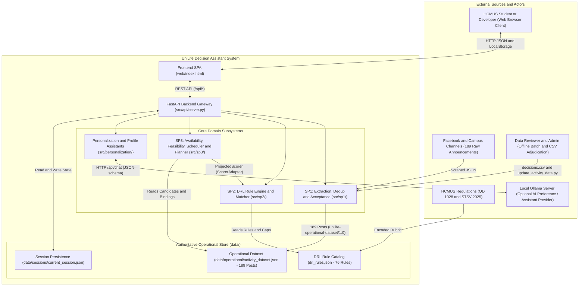
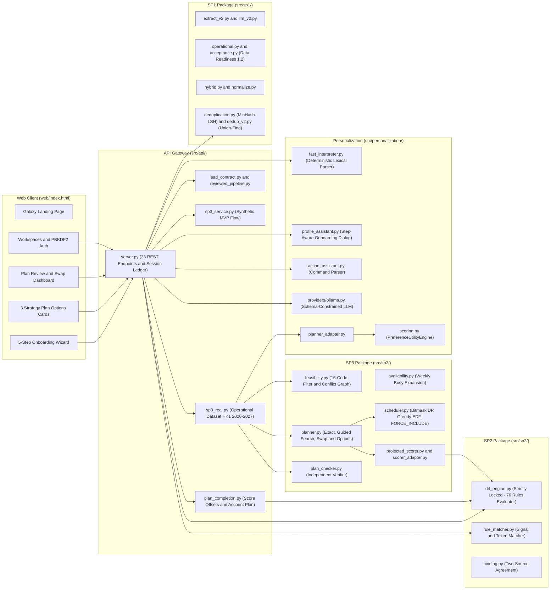

# System Architecture Overview & Engineering Report Index

**Project:** UniLife — HCMUS Academic Campus Decision Assistant (Project E: SP1 + SP2 + SP3 + Personalization)  
**Version:** `1.2.0` (`sp3-planner/0.2`, `sp1-store-v2`, `personalization-features/0.1`)  
**Regulatory Domain:** VNU-HCM University of Science (HCMUS) Student Training Point Rubric (*Điểm Rèn Luyện* — ĐRL, Decision `1028/QĐ-KHTN-CTSV` & `STSV2025`)

---

## 1. Documentation Suite Index

This technical report suite documents the complete software architecture, mathematical foundations, algorithmic complexity, empirical benchmarks, and data engineering pipelines of the **Academic Campus Decision Assistant (UniLife)**.

| Document | Scope & Primary Focus | Key Artifacts Included |
| :--- | :--- | :--- |
| **[00_SYSTEM_ARCHITECTURE_OVERVIEW.md](./00_SYSTEM_ARCHITECTURE_OVERVIEW.md)** | System-level C4 architecture, cross-module contracts, safety invariants, and structural gap analysis | System Context, Container & Component Diagrams, API Contract Matrix, Technical Debt Audit |
| **[01_FRONTEND_ARCHITECTURE_AND_OPERATIONS.md](./01_FRONTEND_ARCHITECTURE_AND_OPERATIONS.md)** | Frontend Single-Page Application ([web/index.html](../../web/index.html)) structural design, state management, and operational flows | Layered Architecture, Component Hierarchy, State Machines (Preview/Commit, SP3 Stepper, AI Confirmation), Sequence Diagrams |
| **[02_BACKEND_ALGORITHMS_COMPLEXITY_AND_PROOFS.md](./02_BACKEND_ALGORITHMS_COMPLEXITY_AND_PROOFS.md)** | Formal algorithms, time/space complexity derivations, mathematical proofs, and empirical benchmarking across SP1, SP2, SP3, and Personalization | Proofs for MinHash-LSH, Subadditive Capped Scoring, Bitmask Subset DP Left-Shift Lemma, Antimatroid Pruning, Cardinality Dominance, Live Benchmarks |
| **[03_DATA_ENGINEERING_AND_PIPELINE_ARCHITECTURE.md](./03_DATA_ENGINEERING_AND_PIPELINE_ARCHITECTURE.md)** | Data collection, hybrid rule-LLM extraction store, schema projection, anti-leakage splits, and human-in-the-loop governance | Data Lineage Diagrams, Layer A vs. Layer B Contract Mapping, Wilson 95% CI Readiness Metrics, Red-Team Prompt Injection Analysis |
| **[04_AI_LLM_AND_PROMPT_ENGINEERING.md](./04_AI_LLM_AND_PROMPT_ENGINEERING.md)** | AI sandboxing architecture, offline Kaggle batch LLM (`Qwen/Qwen3.5-4B`), and runtime preference interpreter (`FAST_RULES` + Ollama `qwen3:4b`) | Two-Prompt Candidate-ID Grounding, Lenient Replay Recovery, Two-Tier Lexical/AI Dispatch, Post-Schema Hallucination Guardrails |
| **[05_TESTING_VERIFICATION_AND_CICD.md](./05_TESTING_VERIFICATION_AND_CICD.md)** | Multi-layer QA pyramid (1,776 pytest cases), runtime self-verification, property-based oracles, Chromium E2E/XSS probing, and CI/CD gates | Independent `check_plan()` Verifier Matrix, 200-Seed Brute-Force & Grid Oracles, Playwright XSS Probes, 53-File SHA-256 Lock |

---

## 2. Executive Summary & System Context

University students at VNU-HCMUS receive unstructured activity announcements across fragmented social channels (Facebook fanpages of the Office of Student Affairs, Youth Union, Student Association, academic faculties, and clubs). Determining whether an announcement is eligible for **Training Points (ĐRL)**, mapping it to the 76-rule university rubric (`C1`–`C5`), verifying completion evidence, and constructing a conflict-free personal schedule to reach a target semester score (e.g., 80/100 *Tốt* or 90/100 *Xuất sắc*) is an error-prone combinatorial decision problem.

**UniLife** solves this problem through a deterministic, contract-driven four-stage architecture:
1. **SP1 (Information Extraction & Deduplication):** Transforms raw Vietnamese announcements into structured 14-field activity records using a two-layer Hybrid Rule + Offline LLM (`Qwen/Qwen3.5-4B`) pipeline with MinHash-LSH near-duplicate detection and human-in-the-loop review gates.
2. **SP2 (Deterministic Regulation Rule Engine):** Evaluates confirmed and projected student records against the 76 encoded rules of Decision `1028/QĐ-KHTN-CTSV` and `STSV2025`, enforcing two-tier score caps (criterion caps and category caps `C1`–`C5`) and overall semester bounds $[0, 100]$. The engine itself is strictly locked to preserve team verification integrity, while student account baseline offsets are applied non-intrusively via `plan_completion.py`.
3. **SP3 (Feasibility, Interval Scheduler & Combinatorial Subset Planner):** Resolves student free-time intervals, verifies 16 per-activity feasibility constraints, schedules fixed and flexible-window activities via Exact Bitmask Dynamic Programming or Multi-Rule Greedy EDF (with `FORCE_INCLUDE` pinning and conflict avoidance), and searches the power set of eligible candidates to optimize an 8-tuple lexicographic objective. It generates 3 distinct strategic plan options (Balanced, Fast Track, High Preference) and supports interactive single-activity swap previews.
4. **Personalization & Conversational Assistants (AI-Assisted Contract & Deterministic Utility):** Translates natural-language student onboarding dialogues into a structured student profile (`profile_assistant.py`) and preference contract (`StudentPreference`) via instant lexical rules or local Ollama inference, parses quick action commands (`action_assistant.py`), enforces explicit human confirmation, applies hard exclusions, and injects a deterministic weighted utility callback into SP3.

---

## 3. Container & Component Architecture

The codebase is organized into five Python packages under [src/](../../src/), an offline batch toolchain under [scripts/](../../scripts/), an authoritative operational data lake under [data/operational/](../../data/operational/), and a zero-build Single-Page Application under [web/index.html](../../web/index.html).

### Module Inventory & Responsibilities

| Subsystem | Module Path | Responsibility |
| :--- | :--- | :--- |
| **API Layer** | [src/api/server.py](../../src/api/server.py) | FastAPI routing (33 endpoints), dual-mode evaluation, `/api/commit` ledger, assistant gateways, preference caching |
| **API Layer** | [src/api/plan_completion.py](../../src/api/plan_completion.py) | Bridges student account scoreboard baseline with SP3 planning, applying trusted category offsets externally to preserve SP2 engine locks |
| **API Layer** | [src/api/sp3_real.py](../../src/api/sp3_real.py) | Operational planning orchestration (`?source=real`) over `data/operational/activity_dataset.json` (189 posts accounted for) |
| **API Layer** | [src/api/sp3_service.py](../../src/api/sp3_service.py) | Synthetic MVP planning orchestration (`?source=synthetic`) over `main_flow_integration.json` |
| **API Layer** | [src/api/lead_contract.py](../../src/api/lead_contract.py) | 15-field draft to 14-field publication gate, URL canonicalization, dataset audit |
| **SP1** | [src/sp1/operational.py](../../src/sp1/operational.py) & [src/sp1/acceptance.py](../../src/sp1/acceptance.py) | Authoritative operational dataset builder & `activity-acceptance/1.2` verification policy |
| **SP1** | [src/sp1/extract_v2.py](../../src/sp1/extract_v2.py) & [src/sp1/llm_v2.py](../../src/sp1/llm_v2.py) | Layer A regex extractor and candidate-grounded offline LLM prompt builder |
| **SP1** | [src/sp1/deduplication.py](../../src/sp1/deduplication.py) & [src/sp1/dedup_v2.py](../../src/sp1/dedup_v2.py) | MinHash-LSH (128 perms, $\tau=0.75$) and Union-Find duplicate clustering |
| **SP2** | [src/sp2/drl_engine.py](../../src/sp2/drl_engine.py) | Rule config auditor, flat-fact rule evaluator, two-tier cap enforcement (strictly locked 53-file integrity) |
| **SP2** | [src/sp2/rule_matcher.py](../../src/sp2/rule_matcher.py) & [src/sp2/binding.py](../../src/sp2/binding.py) | Signal matcher, token overlap fallback, and rule binding catalog |
| **SP3** | [src/sp3/scheduler.py](../../src/sp3/scheduler.py) & [src/sp3/contract.py](../../src/sp3/contract.py) | Whole-set interval scheduler: Exact Bitmask DP, Greedy EDF, and `FORCE_INCLUDE` contract revision 0.2.1 |
| **SP3** | [src/sp3/planner.py](../../src/sp3/planner.py) & [src/sp3/plan_checker.py](../../src/sp3/plan_checker.py) | Combinatorial subset planner (Exact & Guided Search), 3 strategy options generator, swap preview, and independent verifier |
| **Personalization** | [src/personalization/profile_assistant.py](../../src/personalization/profile_assistant.py) | Step-aware multi-turn conversational onboarding assistant for student profile extraction |
| **Personalization** | [src/personalization/action_assistant.py](../../src/personalization/action_assistant.py) | Natural language command interpreter for instant dashboard actions |
| **Personalization** | [src/personalization/fast_interpreter.py](../../src/personalization/fast_interpreter.py) & [src/personalization/scoring.py](../../src/personalization/scoring.py) | Fast lexical rule interpreter (~0.55 ms), Ollama client, and `PreferenceUtilityEngine` |
| **Frontend** | [web/index.html](../../web/index.html) | Single-page application: Galaxy landing, 5-step registration wizard, 15-min calendar grid, 3-strategy options cards, review dashboard |

---

## 4. Core Architectural Principles & Safety Invariants

The system enforces six non-negotiable engineering invariants across all layers:

1. **One Authoritative Operational Dataset (ADR-0003 & Acceptance 1.2):**
   - The runtime reads exactly one file: `data/operational/activity_dataset.json` (schema `unilife-operational-dataset/1.0`), built by `scripts/update_activity_data.py`.
   - All 189 posts of the operational corpus are accounted for (129 non-test posts with 19 stated facts and evidence spans, 60 frozen test posts under access log, 63 human corrections bound to text SHA-256 fingerprints). Legacy stores (`activity_store_v2.json`, `data/handover/*`) were fully retired.
2. **Strict 53-File Team Lock Integrity:**
   - The core DRL engine ([src/sp2/drl_engine.py](../../src/sp2/drl_engine.py)) is part of the 53 protected team files. Any student scoreboard offsets are injected non-intrusively outside the engine via `plan_completion.py`, guaranteeing 100% SHA checksum preservation.
3. **Pure Preview vs. Idempotent Commit Separation:**
   - `POST /api/evaluate` is a pure function with zero side effects on server state or the LSH deduplication index.
   - `POST /api/commit` re-evaluates the payload from scratch against the authoritative server-side scoreboard (`session_scores`) and per-student MinHash-LSH index, preventing client tampering or double-counting.
4. **Two-Boundary LLM Sandboxing (No Direct Scoring or Scheduling by AI):**
   - Neither the offline extraction LLM (`Qwen/Qwen3.5-4B`) nor runtime assistants (Ollama) can invent dates, award DRL points, or build schedules.
   - All LLM outputs are schema-constrained into Pydantic models (`extra="forbid"`) and require explicit student confirmation before reaching SP3.
5. **Whole-Set Scoring, Force-Include Feasibility & Verification:**
   - Because SP2 category caps make scoring subadditive, candidate subsets are scheduled as a whole and scored chronologically by `ProjectedScorer`.
   - Pinned activities (`FORCE_INCLUDE`) are reserved first; if conflicts occur, fallback strategies are computed. Every plan is audited at runtime by [src/sp3/plan_checker.py](../../src/sp3/plan_checker.py).

---

## 5. REST API Contract Matrix (33 Endpoints)

| Endpoint | Method | Subsystem | Request Contract | Response / Behavior |
| :--- | :---: | :--- | :--- | :--- |
| `/api/health` | `GET` | Gateway / SP2 | None | Audits `drl_rules.json`, returns rule count (76), LSH index size, operational dataset readiness |
| `/api/students` | `GET` | Profile | None | Lists demo student profiles from `data/student_profile.json` |
| `/api/profile` | `GET` | Profile / SP2 | `?student_id=...` | Returns student metadata + current/projected category scores initialized from default awards |
| `/api/scores` | `GET` | Session Ledger | `?student_id=...` | Authoritative session scoreboard (`current`, `projected`, `total_hypothetical`) |
| `/api/rules` | `GET` | SP2 | None | Full 76-rule catalog, category caps (`C1`..`C5`), and regulation metadata |
| `/api/activities` | `GET` | SP1 / Ledger | None | Combined list of student-committed activities + baseline activities + `review_queue` |
| `/api/evaluate` | `POST` | SP1 to SP2 | `EvaluationRequest` | Pure preview: extracts 14-field record, checks LSH duplicates, runs rule matcher and SP2 engine |
| `/api/commit` | `POST` | SP1 to SP2 | `CommitRequest` | Re-evaluates and persists activity to `session_committed` or `review_queue` |
| `/api/reset` | `POST` | Session Ledger | None | Wipes `session_committed`, `session_scores`, `session_preferences`, and `review_queue` |
| `/api/e2e-cases` | `GET` | QA / Dev | None | Returns the 5 standardized E2E acceptance test cases and expected outputs |
| `/api/pipeline/demo` | `POST` | SP1 to SP2 | `{"case_id": 1..5}` | Server-fixture E2E execution for acceptance verification |
| `/api/sp2/evaluate` | `POST` | SP2 | `VerifiedSnapshotRequest` | Evaluates academic snapshot (GPA, violations, flat facts) via `evaluate_rules_progress` |
| `/api/lead/audit` | `GET` | Governance | None | Audits dataset integrity, unverified rules (`R23`), and cross-post duplicate groups |
| `/api/profile-assistant/interpret` | `POST` | Personalization | `ProfileAssistantRequest` | Step-aware conversational onboarding agent extracting student profile, target score, and free time |
| `/api/assistant/interpret` | `POST` | Personalization | `AssistantRequest` | Natural language command interpreter for instant dashboard actions |
| `/api/sp3/availability/resolve` | `POST` | SP3 | `AvailabilityResolveRequest` | Expands weekly busy template across term into disjoint free intervals |
| `/api/sp3/catalog` | `GET` | SP1 to SP3 | `?source=synthetic\|real` | Returns 20 synthetic activities or operational dataset (189 posts accounted for) |
| `/api/sp3/demo/plan` | `POST` | SP3 to SP2 | `SP3DemoPlanRequest` | Runs `first_plan`, `replan`, or `what_if_skip` on synthetic fixture or operational dataset |
| `/api/sp3/personalized/plan` | `POST` | Pers to SP3 | `PersonalizedPlanRequest` | Executes SP3 planner with confirmed student preference utility callback |
| `/api/sp3/personalized/options` | `POST` | Pers to SP3 | `PersonalizedPlanOptionsRequest` | Computes 3 strategic plan alternatives (Balanced, Fast Track, High Preference) |
| `/api/sp3/personalized/swap-preview`| `POST` | Pers to SP3 | `PlanSwapPreviewRequest` | Evaluates feasibility and score/utility delta for swapping an activity in a confirmed plan |
| `/api/sp3/personalized/add-preview` | `POST` | Pers to SP3 | `PlanAddPreviewRequest` | Simulates adding a candidate activity to an existing schedule |
| `/api/sp3/personalized/remove-preview`| `POST`| Pers to SP3 | `PlanRemovePreviewRequest` | Simulates removing an activity and calculates score drop |
| `/api/sp3/personalized/alternatives` | `POST`| Pers to SP3 | `PlanAlternativesRequest` | Suggests non-conflicting replacement activities for a specific scheduled slot |
| `/api/sp3/personalized/what-if-skip` | `POST`| Pers to SP3 | `WhatIfSkipRequest` | Simulates skipping a planned activity and calculates impact |
| `/api/sp3/confirmed-plan` | `POST` | SP3 Ledger | `ConfirmedPlanSaveRequest` | Persists confirmed student semester plan with status tracking |
| `/api/sp3/confirmed-plan/progress` | `GET` | SP3 Ledger | `?student_id=...` | Tracks completion progress of activities in confirmed student plan |
| `/api/sp3/confirmed-plan/complete` | `POST` | SP3 Ledger | `ConfirmedPlanCompleteRequest`| Marks scheduled activity as completed, updating DRL scoreboard |
| `/api/preferences/ai-health` | `GET` | Personalization | None | Checks local Ollama connectivity and model availability |
| `/api/preferences/interpret` | `POST` | Personalization | `InterpretPreferenceRequest` | Parses Vietnamese preference text via `FAST_RULES` (~0.55 ms) or Ollama |
| `/api/preferences/confirmed` | `GET/PUT/DELETE` | Personalization | `student_id` / payload | Reads, saves, or deletes the confirmed preference contract per student |

---

## 6. Architectural Seam & Technical Debt Audit

Because the system evolved across six parallel workstreams over six weeks while preserving strict SHA file locks ([docs/TEAM_SOURCE_LOCK_20261029.json](../../docs/TEAM_SOURCE_LOCK_20261029.json)), the following architectural seams and their resolution status are tracked:

1. **Student Ledger Integration across SP1, SP2 and SP3 (RESOLVED via `plan_completion.py`):**
   - *Previous state:* Saving an activity mutated `session_scores`, but SP3 planning used static fixtures.
   - *Current state:* `AccountPlanScoring` in `src/api/plan_completion.py` bridges the student's active scoreboard baseline to SP3. It calculates category offsets $\delta_c$ and applies them externally through `_apply_category_offsets`, strictly safeguarding the checksum of `src/sp2/drl_engine.py`.
2. **Consolidation of SP1 Data Pipeline (RESOLVED via ADR-0003):**
   - *Previous state:* Co-existence of V1 runtime extractor, legacy V2 store (`activity_store_v2.json`), and handover folder (`data/handover/`).
   - *Current state:* All legacy stores and runtime ingestion were removed. A single authoritative operational file `data/operational/activity_dataset.json` (189 posts accounted for) powers `?source=real`, built deterministically via `scripts/update_activity_data.py`.
3. **Interactive Plan Modification & Options (RESOLVED via REST Options & Swap Endpoints):**
   - *Previous state:* Hardcoded 3-step sequential scenarios (`first_plan` $\to$ `replan` $\to$ `what_if_skip`).
   - *Current state:* Full interactive plan manipulation via `/api/sp3/personalized/options` (generating 3 distinct strategies), `/api/sp3/personalized/swap-preview`, and `FORCE_INCLUDE` contract revision 0.2.1.
4. **SP2 Lock Preservation & Offset Handling:**
   - To maintain `scripts/check_team_source_integrity.py` validation (53/53 locked files), category offsets for points already earned are applied via a functional wrapper around `evaluate_rule_conditions`, avoiding modifications to the frozen rule engine.
5. **Single-File Frontend Monolith (`web/index.html`):**
   - At ~8,000 lines, `web/index.html` serves as a comprehensive single-page zero-build client containing the 5-step onboarding wizard, 15-minute drag busy calendar, 3-strategy options cards, and live countdown review dashboard. Future refactoring can extract these views into ES modules or framework components.
6. **High-Performance SP3 Schedule Optimization Roadmap (Branch `Minh_Tien`):**
   - *Current baseline on main:* The initial merge in PR #8 ported preliminary guided search and EDF heuristics (`bdbb81d`), while PR #11 prioritized the end-to-end UI/UX onboarding and operational dataset.
   - *Advanced engine:* The comprehensive combinatorial optimization suite developed under [schedule_optimization/](../../schedule_optimization/) and verified by [tests/sp3_optimization/](../../tests/sp3_optimization/) delivers the final algorithmic leap: Fast v2 Available-EDF scheduling (resolving the Earliest Completion Time trap for up to 64 flexible activities with a $30,067\times$ speedup over Exact Bitmask DP), 5-phase Guided Search v2 for large catalogs ($N > 12$), and rigorous stability preservation across replans. This production-grade scheduling engine is fully benchmarked and designated for upcoming promotion to `main`.
