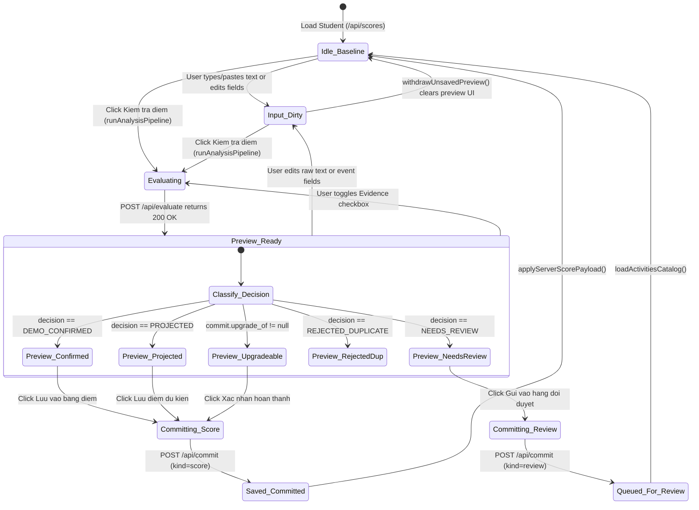
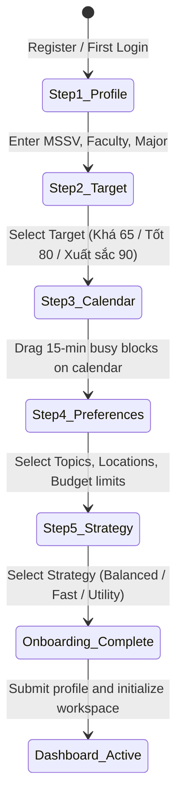
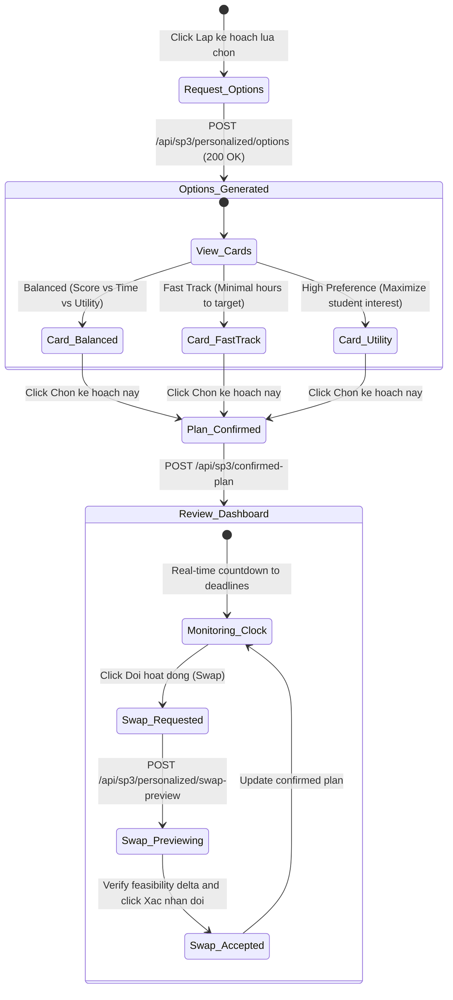
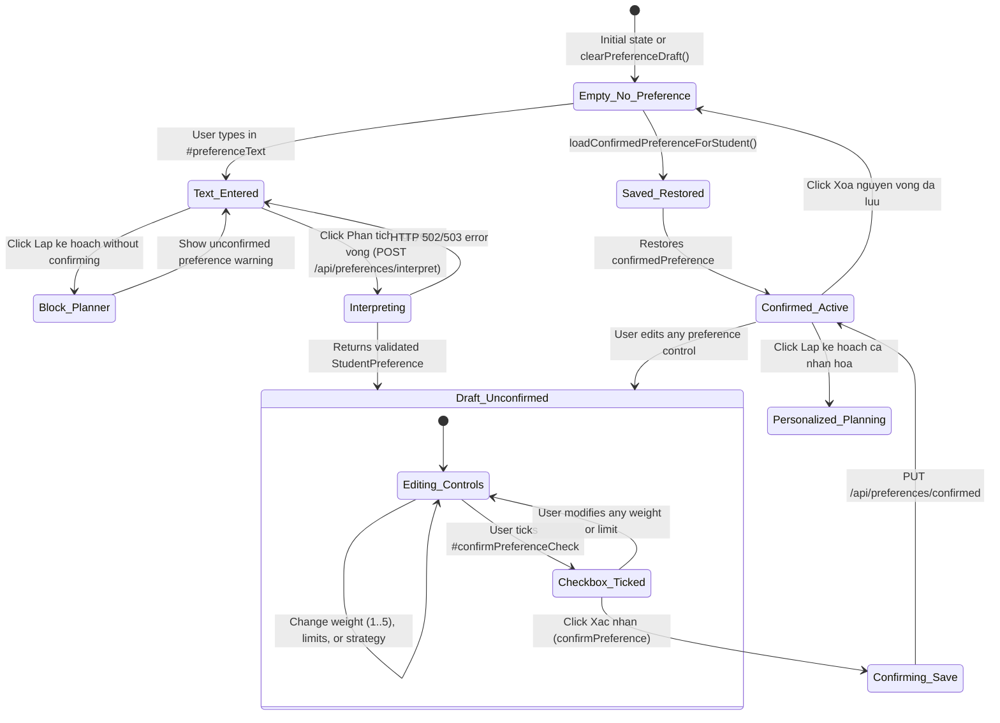
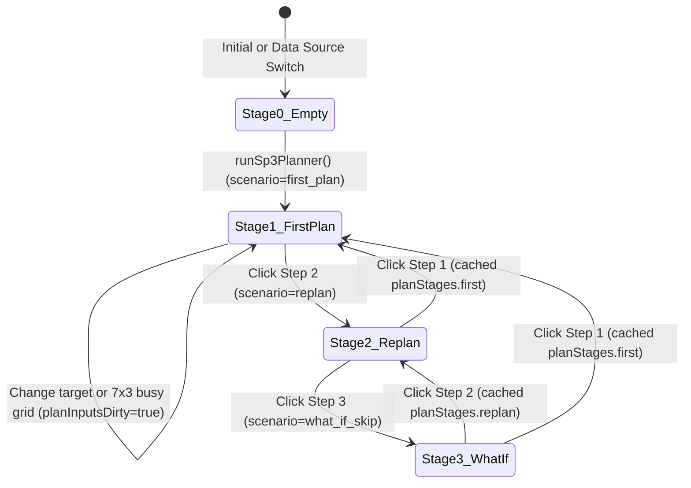
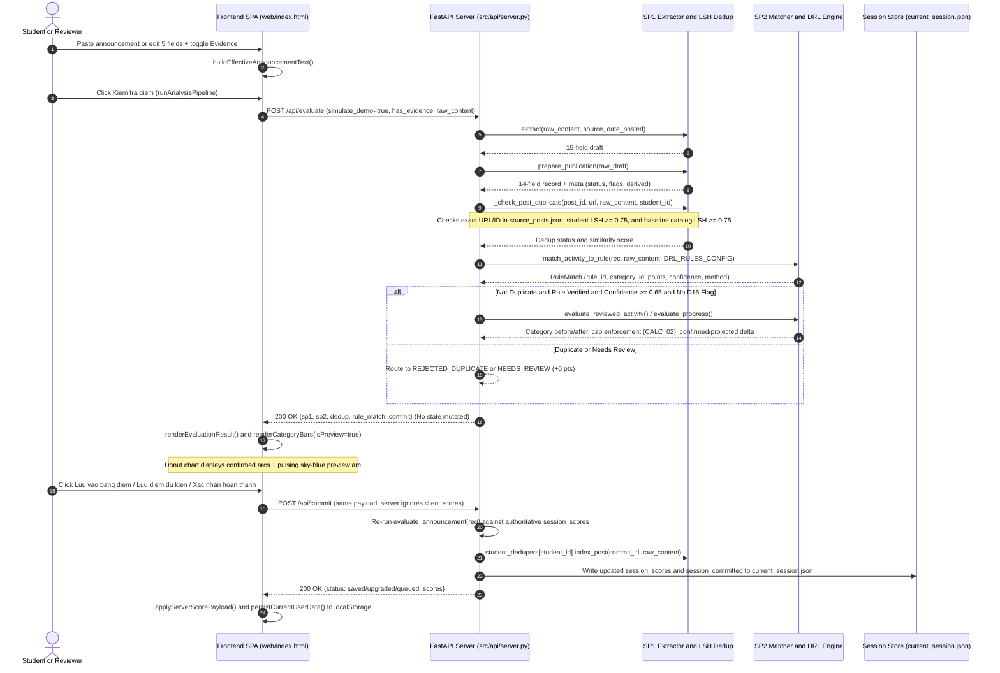
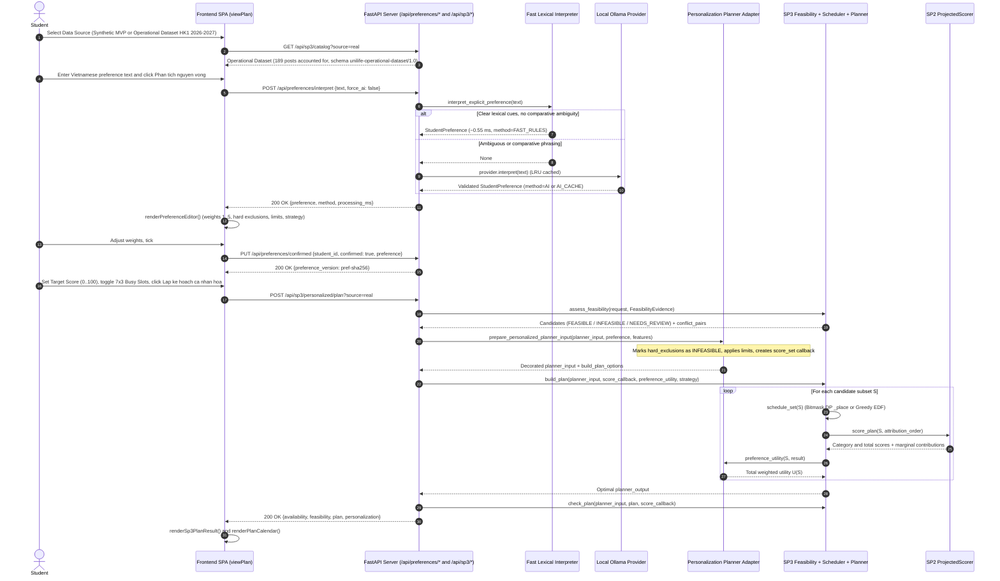

# Frontend Architecture & Operational Layer Specification

**Component:** UniLife Web Client ([web/index.html](../../web/index.html))  
**Architecture Style:** Zero-Build Single-Page Application (Vanilla ES2022 + Tailwind CSS Runtime + WebCrypto API)  
**Size & Footprint:** ~8,000 lines (HTML5 templates, scoped theme CSS, reactive state controllers, 5-step wizard, interactive SVG donut, 15-min calendar grid, review dashboard)

---

## 1. Layered Frontend Architecture

Despite being packaged as a single self-contained deliverable ([web/index.html](../../web/index.html)) for zero-dependency deployment via FastAPI's `FileResponse`, the frontend is internally structured into **five distinct operational layers**:

```mermaid
flowchart TB
    subgraph L1["Layer 1: Presentation and Theme Engine"]
        Landing["Galaxy Landing Portal (#landingPage) - Hero, Features Grid, Orbit SVG"]
        Shell["Workspace Shell (#workspaceApp) - Top Status Bar, Sidebar, Main Viewport"]
        Theme["Dual-Theme CSS Engine - Dark Mode (#080c14) and Light Mode (.light-theme)"]
        ModeCSS["Role-Based Visibility Filter - body:not(.dev-mode) .dev-only"]
    end

    subgraph L2["Layer 2: Workspace Views and Interactive Widgets"]
        V_Dash["viewDashboard - Overview Cards, Semester Bar, Quick Actions"]
        V_Calc["viewCalculator (Dual Sub-Mode) - Tracker View and SP1-SP2 Activity Evaluator"]
        V_Plan["viewPlan (SP3 Smart Planner) - 7x3 Availability Grid, AI Assistant, Weekly Calendar"]
        V_Act["viewActivities (Dual Sub-Mode) - Discover View and Collected Source Catalog"]
        V_Snap["viewSnapshot - Academic GPA and Flat-Fact DRL Simulator"]
        V_Dev["Developer Workspaces (.dev-only) - viewTestSuites and viewInspector"]
        Modals["Modal Overlays - Auth Modal (#loginModal) and Activity Detail Drawer"]
    end

    subgraph L3["Layer 3: View-Model and Dual-Mode Formatting Adapters"]
        FmtMode["Mode-Aware Copy and Badge Formatter (formatExplanationForMode)"]
        FormSynth["Announcement Text Synthesizer (buildEffectiveAnnouncementText)"]
        CalEngine["Calendar and Interval Geometry Engine (subtractIntervals, diffPlans)"]
        DonutRender["SVG Donut and Category Progress Renderer (renderCategoryBars)"]
    end

    subgraph L4["Layer 4: Client State and Local Persistence Manager"]
        MemState["In-Memory Reactive State (currentStudent, studentCategoryScores, planStages)"]
        GenGuard["Concurrency and Stale-State Guards (plannerRequestGeneration, planInputsDirty)"]
        AuthCrypto["WebCrypto PBKDF2 Auth Engine (120k iters, SHA-256, Constant-Time Compare)"]
        LocalDB["Browser LocalStorage Partitioning (unilife_users, unilife_data_MSSV)"]
    end

    subgraph L5["Layer 5: REST Transport and Fault-Tolerance Layer"]
        Health["Health and Capability Probing (checkBackendHealth, checkPreferenceAIHealth)"]
        EvalAPI["SP1/SP2 Intake and Commit Client (/api/evaluate, /api/commit, /api/scores)"]
        PlanAPI["SP3 and Personalization Client (/api/sp3/catalog, /api/sp3/demo/plan)"]
        PrefAPI["Preference Contract Client (/api/preferences/interpret, /api/preferences/confirmed)"]
    end

    L1 --> L2
    L2 --> L3
    L3 <--> L4
    L4 <--> L5
```

### Detailed Layer Breakdown

1. **Layer 1 — Presentation & Theme Engine ([web/index.html:36-360](../../web/index.html#L36-L360)):**
   - **Two-Screen Root Topology:** Separates the marketing/onboarding portal (`#landingPage`, styled with animated CSS starfields `.galaxy-stars` and horizon gradients `.galaxy-horizon`) from the application workspace (`#workspaceApp`), using smooth opacity/transform transitions (`showWorkspace()`).
   - **Declarative Developer-Mode Gating:** Uses a single CSS rule `body:not(.dev-mode) .dev-only { display: none !important; }` combined with programmatic copy adapters so that technical contract identifiers (`rule_id`, `activity_id`, `NEEDS_REVIEW`, `CALC_02`, `DEMO_ONLY`, 14-field JSON tables) are completely hidden from standard students while remaining instantaneously inspectable in Developer Mode.
   - **Scoped Light/Dark Theme Engine:** Implements attribute-selector overrides (`#workspaceApp.light-theme [class*="bg-[#0b101b]"]`) persisted in `localStorage["unilife_theme"]`.

2. **Layer 2 — Workspace Views & Interactive Widgets ([web/index.html:517-1770](../../web/index.html#L517-L1770)):**
   - **Single-Container Multi-View Router (`switchTab(tabName, subMode)`):** Controls visibility across 7 logical workspaces (`viewDashboard`, `viewCalculator`, `viewPlan`, `viewActivities`, `viewSnapshot`, `viewTestSuites`, `viewInspector`).
   - **Sub-Mode Multiplexing:** Both `viewCalculator` and `viewActivities` multiplex two distinct user experiences over a shared DOM container:
     - `viewCalculator` switches between `'tracker'` (*Theo dõi điểm rèn luyện* — full-width scoreboard & saved activity history) and `'calculate'` (*Tính điểm hoạt động* — split-pane SP1 extractor + SP2 live preview scoreboard).
     - `viewActivities` switches between `'discover'` (*Khám phá hoạt động* — student-friendly card grid with search/domain filters) and `'catalog'` (*Kho hoạt động* — full ingestion table with SP1 QA status, blocked drafts, and review queue).

3. **Layer 3 — View-Model & Dual-Mode Formatting Adapters ([web/index.html:1829-2244](../../web/index.html#L1829-L2244), [web/index.html:3828-4548](../../web/index.html#L3828-L4548)):**
   - **Dual-Input Announcement Synthesizer (`buildEffectiveAnnouncementText()`):** Supports both raw Facebook post pasting (`currentActivityInputMode === "paste"`) and a 5-field structured form (`currentActivityInputMode === "manual"`). If the user pastes a multi-line announcement without touching the 5 extracted boxes (`!eventFieldsEditedByUser`), the raw text is sent untouched to SP1 so missing fields (e.g., E2E Case 3 missing online completion requirements) trigger authentic SP1 flags. If the user edits any box, it synthesizes a normalized Vietnamese announcement string for re-evaluation.
   - **Non-Mutating SVG Donut & Progress Bar Preview (`renderCategoryBars()`):** Renders a multi-segment SVG ring (`#drlDonutSegments`, circumference $2\pi r \approx 100$ at $r = 15.9155$) where confirmed category scores appear in solid category colors (`C1` blue, `C2` teal, `C3` violet, `C4` orange, `C5` pink) and pending/projected points appear as an animated sky-blue arc (`#7dd3fc`).
   - **Client-Side Interval Algebra & Weekly Calendar Grid (`subtractIntervals()`, `diffPlans()`, `renderPlanCalendar()`):** Computes interval differences in milliseconds to display newly busy/free slots during replanning and renders scheduled activity blocks onto a 7-day $\times$ 14-hour (07:00–21:00, $672\text{ px}$ height) CSS grid with collision column splitting.

4. **Layer 4 — Client State & Local Persistence Manager ([web/index.html:2365-2750](../../web/index.html#L2365-L2750)):**
   - **WebCrypto PBKDF2 Authentication:** Implements browser-local student account registration and login (`deriveLocalPasswordHash()`) using `window.crypto.subtle` (`PBKDF2`, `SHA-256`, $120,000$ iterations, 128-bit random salt) and a constant-time string comparator (`constantTimeEqual()`) to prevent timing side-channels.
   - **Per-MSSV Isolated Storage (`unilife_data_<MSSV>`):** Partitions each student's category scores, saved activities, target score, and 3-stage SP3 plan history (`planStages`) in `localStorage`, synchronizing with the FastAPI backend session on login and switch.
   - **Asynchronous Generation Guards (`plannerRequestGeneration`):** Monotonically increments a request counter on every SP3 planner call or student switch; stale HTTP responses arriving out-of-order are discarded (`if (requestGeneration !== plannerRequestGeneration) return;`).

---

## 2. Component & View Hierarchy Diagram

```mermaid
graph TD
    Root["Document Root (web/index.html)"]
    Root --> Landing["#landingPage (Marketing and Portal)"]
    Root --> Workspace["#workspaceApp (Main Application Shell)"]
    Root --> LoginModal["#loginModal (PBKDF2 Login and Registration)"]
    Root --> OnboardingWizard["#onboardingModal (5-Step Onboarding Wizard)"]
    Root --> SwapModal["#swapPreviewModal (Interactive Plan Swap Preview)"]

    Landing --> L_Nav["Fixed Glassmorphic Navbar and Task Dropdown"]
    Landing --> L_Hero["#home Hero, Floating Progress Cards and CTA"]
    Landing --> L_Feat["#features 6-Card Task Launcher Grid"]
    Landing --> L_How["#how-it-works 5-Step Process Guide"]

    OnboardingWizard --> Step1["Step 1: Student Profile and Faculty/Program"]
    OnboardingWizard --> Step2["Step 2: DRL Semester Target (e.g. 80-90)"]
    OnboardingWizard --> Step3["Step 3: 15-Min Drag-and-Drop Busy Calendar"]
    OnboardingWizard --> Step4["Step 4: Topics of Interest and Campus Exclusions"]
    OnboardingWizard --> Step5["Step 5: Strategy Selection (Balanced / Fast / Utility)"]

    Workspace --> TopBar["Top Status Header"]
    Workspace --> BodyFlex["Main Flex Container"]

    TopBar --> ModeSwitch["User / Developer Mode Toggle (#btnModeUser, #btnModeDev)"]
    TopBar --> ThemeToggle["Light / Dark Theme Switch (#btnThemeToggle)"]
    TopBar --> DevPills[".dev-only API Health and SP2 Simulation Toggle"]
    TopBar --> UserMenu["Student Profile Pill and Account Switcher (#userDropdown)"]

    BodyFlex --> Sidebar["#sidebarNav (Responsive Navigation)"]
    BodyFlex --> MainView["Main Scrollable Viewport"]

    MainView --> V1["#viewDashboard (Student Overview and Live Summary)"]
    MainView --> V2["#viewCalculator (SP1-SP2 Evaluator and DRL Tracker)"]
    MainView --> V3["#viewPlan (SP3 Smart Schedule Planner and Options Cards)"]
    MainView --> V4["#viewActivities (Activity Discovery and Operational Catalog)"]
    MainView --> V5["#viewReviewDashboard (Plan Review, Countdown Clock, Swap)"]
    MainView --> V6["#viewProfile (Student Program and Semester Goals)"]
    MainView --> V7["#viewSchedule (15-Min Free/Busy Calendar Manager)"]
    MainView --> V8["#viewTestSuites (.dev-only 5 E2E Acceptance Runner)"]
    MainView --> V9["#viewInspector (.dev-only Contract Inspector)"]

    V3 --> V3_Options["#planOptionsContainer (3 Strategy Cards: Balanced, Fast-Track, High-Preference)"]
    V3 --> V3_Stepper["#plannerActiveResult (3-Stage Stepper: First Plan, Replan, What-If)"]
    V3 --> V3_Calendar["#planCalendarGrid (Weekly Calendar with Collision Columns)"]
```

---

## 3. Core Frontend State Machines

### 3.1 Two-Phase Preview vs. Commit State Machine (`viewCalculator`)

A foundational UX and data-integrity requirement in UniLife is that **previewing an announcement never mutates the student's saved score**. Furthermore, editing any input field immediately withdraws any unsaved preview arc from the scoreboard so stale projections never linger.

### 3.2 5-Step Registration Onboarding State Machine (`#onboardingModal`)

First-time users or students setting up a new semester journey are guided through an interactive 5-step onboarding wizard with full reconciliation against the backend:

### 3.3 Interactive Plan Options & Swap Preview State Machine (`viewPlan` & `#viewReviewDashboard`)

When generating semester schedules, the system computes **3 distinct strategy cards** and allows 1-click swap previews:

### 3.2 AI Personalization Human-in-the-Loop Confirmation State Machine (`viewPlan`)

To guarantee that an LLM never silently alters schedule constraints or rankings, the frontend enforces a strict confirmation state machine before `runSp3Planner()` is allowed to call `/api/sp3/personalized/plan`:

### 3.3 SP3 Three-Stage Planning Journey State Machine (`viewPlan`)

---

## 4. Operational Sequence Diagrams

### 4.1 End-to-End Activity Evaluation, Preview, and Commit Flow

### 4.2 AI-Assisted Personalized SP3 Planning Flow

---

## 5. Interactive Calendar & Visual Coordinate Mapping

The SP3 weekly schedule board (`renderPlanCalendar()`, [web/index.html:4090-4202](../../web/index.html#L4090-L4202)) projects ISO-8601 timestamps onto a 7-column (Monday–Sunday) $\times$ 14-hour (`07:00`–`21:00`) viewport:

- **Vertical Time Mapping:** Each day column has height $H = 672\text{ px}$ covering $T_{\text{span}} = 14 \times 60 = 840\text{ minutes}$ ($0.8\text{ px/minute}$ or $48\text{ px/hour}$). For a scheduled block $[t_{\text{start}}, t_{\text{end}}]$ clamped to $[07:00, 21:00]$:
  $$\text{top\_px} = \frac{\text{minutes\_since\_07:00}(t_{\text{start}})}{840} \times 672, \qquad \text{height\_px} = \max\left(28, \frac{t_{\text{end}} - t_{\text{start}}}{840} \times 672\right)$$
- **Busy-Slot Grid Encoding (`collectBusyIntervals()`):** The 7-day $\times$ 3-shift (*Sáng* `07:00–11:30`, *Chiều* `13:00–17:00`, *Tối* `18:00–21:00`) availability matrix converts cells with `data-free="false"` into explicit ISO-8601 busy intervals anchored to the active dataset's reference week (`2026-11-02` for Synthetic MVP; `2026-10-05` / full-window projection for Real Store V2).
