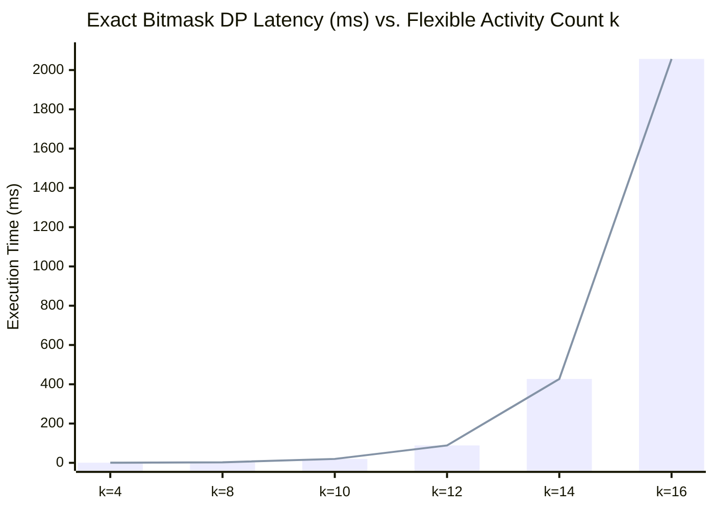

# Backend Technical Report: Algorithms, Complexity, Proofs & Benchmarks

**Scope:** Core algorithms and performance analysis across **SP1** ([src/sp1/](../../src/sp1/)), **SP2** ([src/sp2/](../../src/sp2/)), **SP3** ([src/sp3/](../../src/sp3/)), and **Personalization** ([src/personalization/](../../src/personalization/)).

---

## 1. SP1: Duplicate Detection (MinHash-LSH & Union-Find) and Hybrid Extraction

### 1.1 Near-Duplicate Detection with 3-Word Shingles & MinHash

When students or scrapers collect announcements from multiple Facebook pages, the same event is often reposted with minor edits (extra hashtags, different links, or slightly altered introductions). Comparing a new post against $N$ existing posts word-by-word takes $\mathcal{O}(N \cdot L)$ time, which is too slow as the catalog grows.

In [src/sp1/deduplication.py](../../src/sp1/deduplication.py), each post is converted into a set of **3-word shingles** (contiguous 3-word phrases after stripping URLs and lowercasing), and similarity between two posts $A$ and $B$ is measured by **Jaccard Similarity**:

$$J(A, B) = \frac{|A \cap B|}{|A \cup B|} \in [0, 1]$$

Instead of comparing full shingle sets, `compute_minhash` compresses each post into a fixed **128-integer fingerprint** (`num_perm = 128`). For each hash function $h_i$ ($i = 1, \dots, 128$), we store only the smallest hash value among all shingles in the post:

$$\text{sig}_i(A) = \min_{w \in A} h_i(w)$$

#### Why MinHash Works (Short Proof)
- **Claim:** The probability that two posts produce the exact same minimum hash $\text{sig}_i(A) = \text{sig}_i(B)$ equals their Jaccard similarity $J(A, B)$.
- **Proof:**
  1. Consider all unique shingles in the combined set $A \cup B$. Under a random hash function $h_i$, every shingle in $A \cup B$ is equally likely to have the smallest hash value.
  2. The minimum hash of $A$ equals the minimum hash of $B$ **if and only if** the global minimum shingle of $A \cup B$ lies inside the overlap $A \cap B$.
  3. Since there are $|A \cap B|$ overlapping shingles out of $|A \cup B|$ total shingles, this happens with probability:
     $$P(\text{sig}_i(A) = \text{sig}_i(B)) = \frac{|A \cap B|}{|A \cup B|} = J(A, B)$$
  4. Averaging across $m = 128$ independent hash functions gives an unbiased estimate $\hat{J}$ with worst-case standard error $\sigma \le \frac{1}{2\sqrt{128}} \approx 4.4\%$. $\blacksquare$

---

### 1.2 Fast Lookup with Locality-Sensitive Hashing (LSH)

Even with 128-integer signatures, scanning all $N$ posts still takes $\mathcal{O}(N)$ comparisons. `PostDeduplicator` ([src/sp1/deduplication.py](../../src/sp1/deduplication.py)) uses `MinHashLSH(threshold=0.75, num_perm=128)` to split the 128 hashes into $b$ **bands** of $r$ rows each ($b = 14, r = 9$). Two posts are compared only if they match **100% identically in at least one band**.

If two posts have true similarity $s = J(A, B)$:
- Probability that all $r$ rows in one band match: $s^r$
- Probability that at least one of the $b$ bands matches:

$$P_{\text{candidate}}(s) = 1 - (1 - s^r)^b$$

This formula creates a sharp step-function around the threshold $\tau = 0.75$: posts with similarity $\ge 0.75$ almost always collide in at least one bucket, while dissimilar posts are filtered out in $\mathcal{O}(1)$ bucket lookups.

---

### 1.3 Activity-Level Grouping with Union-Find ([src/sp1/dedup_v2.py](../../src/sp1/dedup_v2.py))

In university announcements, two *different* events often share the same template text (for example, the Chess Tournament `#55` and Xiangqi Tournament `#56` share $74.5\%$ text similarity). To avoid false merges, `group_duplicates` combines **time bucketing** with **Union-Find (Disjoint-Set)**:

1. **Same Start-Time Gate:** Two posts are only compared if both state the exact same opening date and time (`window.open`). Posts with missing or defaulted times are never auto-merged.
2. **Merge Rule:** Within the same start-time bucket, two posts are merged into one group via Union-Find (`parent[find(b)] = find(a)`) if:
   $$\text{MinHashSimilarity}(a, b) \ge 0.75 \quad \text{OR} \quad \text{NormalizedTitle}(a) = \text{NormalizedTitle}(b)$$
   If they do not merge, but their titles share $\ge 60\%$ of words, they are flagged as `possible_duplicates` for human review.
3. **Picking the Canonical Record:** For each duplicate group, the most complete post is chosen as the main record using a deterministic sort key (`_completeness`):
   $$\text{Key}(r) = \left(\text{status\_rank},\; -\text{filled\_fields\_count},\; \text{date\_posted},\; \text{post\_id}\right)$$
   where `valid (0) < partial (1) < failed (2)`.

---

### 1.4 Hybrid Rule + LLM Extraction Without Hallucination

In SP1 V2 ([src/sp1/llm_v2.py](../../src/sp1/llm_v2.py) and [src/sp1/hybrid.py](../../src/sp1/hybrid.py)), the offline LLM (`Qwen/Qwen3.5-4B`) is combined with regex rules (`extract_v2.py`) under a strict safety guarantee: **the LLM can never invent dates, URLs, or DRL points**.

- **How it works:** Before calling the LLM, regex rules scan the post and assign fixed IDs to every detected candidate span: titles (`H1..Hn`), dates (`D1..Dn`), times (`T1..Tn`), and URLs (`U1..Un`).
- **Closed-Role Selection:** The LLM is only allowed to output JSON mapping those existing IDs to roles (e.g., `{"D1": "first_start", "D2": "registration_deadline"}`). Any unknown ID is dropped by `parse_roles`.
- **Per-Field Merge Policy ([data/config/merge_policy.json](../../data/config/merge_policy.json)):** Each field is merged using one of four simple rules:
  - `rules`: Always use the regex rule output (`title`, `domain`, `registration_deadline`, `registration_url`).
  - `llm`: Use the LLM's selected candidate (`window_open`, where LLM reached $20/21$ accuracy vs. $18/21$ for rules).
  - `llm_if_rules_null`: Use regex first; fall back to LLM only if regex returned `null` (`window_close`, `multi_session`).
  - `agree_else_review`: Use the value if both agree; otherwise flag `needs_review:<field>` (`post_type`, `mode`).

---

## 2. SP2: Multi-Tier Capped DRL Scoring Engine

### 2.1 Three-Level Score Capping Formula

In [src/sp2/drl_engine.py](../../src/sp2/drl_engine.py), calculating a student's DRL score is **not** a simple sum of activity points. Under Decision `1028/QĐ-KHTN-CTSV`, points pass through three levels of caps:

1. **Criterion Cap (Level 1):** Sum all matched rules within criterion $k$ (e.g., Criterion `1.9` Academic Seminars), then cap at the criterion maximum $\text{Cap}_{\text{crit}}(k)$:
   $$\text{Score}_{\text{crit}}(k) = \min\!\left(\sum_{r \in k} \text{points}(r) \times \text{count}(r),\; \text{Cap}_{\text{crit}}(k)\right)$$
2. **Category Cap (Level 2):** Sum all criteria inside category $c \in \{\text{C1}, \text{C2}, \text{C3}, \text{C4}, \text{C5}\}$, then cap at the category maximum $\text{Cap}_{\text{cat}}(c)$ (e.g., `C1` max 30, `C3` max 25, `C4` max 25):
   $$\text{Score}_{\text{cat}}(c) = \min\!\left(\sum_{k \in c} \text{Score}_{\text{crit}}(k),\; \text{Cap}_{\text{cat}}(c)\right)$$
3. **Semester Total Cap (Level 3):** Sum all 5 categories plus baseline points and clamp to $[0, 100]$:
   $$\text{TotalScore} = \min\!\left(100,\; \max\!\left(0,\; \text{Base} + \sum_{c \in \{\text{C1..C5}\}} \text{Score}_{\text{cat}}(c)\right)\right)$$

---

### 2.2 Diminishing Returns (Subadditivity) & Why SP3 Must Score Whole Sets

Because of the $\min(\dots, \text{Cap})$ operations above, adding two activities together can yield **fewer** points than the sum of each activity scored alone:

$$\text{Gain}(A \cup B) \le \text{Gain}(A) + \text{Gain}(B)$$

- **Concrete Example (E2E Case 4):** Suppose a student already has $22 / 25$ points in Category `C3`. Activity $A$ awards $+5$ points in `C3`, and Activity $B$ awards $+10$ points in `C3`.
  - Scored alone: $\text{Gain}(\{A\}) = +3$ points (hits $25$ cap); $\text{Gain}(\{B\}) = +3$ points (hits $25$ cap).
  - Scored together: $\text{Gain}(\{A, B\}) = +3$ points total — **not** $3 + 3 = 6$!
- **Design Impact:** The SP3 planner ([src/sp3/planner.py](../../src/sp3/planner.py)) **never** adds individual activity points together. Every candidate set $S$ is sent as a whole to `ProjectedScorer` ([src/sp3/projected_scorer.py](../../src/sp3/projected_scorer.py)) to run the real SP2 engine.

---

### 2.3 Order-Invariance of Final Score vs. Order-Dependent Marginal Contributions

When `ProjectedScorer` evaluates a planned set of activities $S = (a_1, a_2, \dots, a_m)$ sorted chronologically by scheduled start time (`attribution_order`), it applies the activities one by one and records each activity's **marginal gain**:

$$\Delta(a_i) = \text{Score}_{\text{cat}}\!\left(\{a_1, \dots, a_i\}\right) - \text{Score}_{\text{cat}}\!\left(\{a_1, \dots, a_{i-1}\}\right)$$

#### Proof of Two Key Properties
1. **Individual Marginal Gains Sum Exactly to the Category Gain:**
   When we add up $\Delta(a_i)$ for all activities in category $c$, intermediate terms cancel out (a telescoping sum):
   $$\sum_{i=1}^{m} \Delta(a_i) = (\text{Score}_1 - \text{Score}_0) + (\text{Score}_2 - \text{Score}_1) + \dots + (\text{Score}_m - \text{Score}_{m-1}) = \text{Score}_m - \text{Score}_0 = \text{Gain}(S)$$
   This explains why earlier activities in a schedule receive full point credit while later activities in the same category receive the capped remainder.
2. **Final Score Does Not Depend on Order:**
   `_check_order_independent` ensures all activity bindings either add to a counter (`INCREMENT`, e.g., `count += 1`) or set a field to a non-conflicting value (`SET`). Since addition is commutative ($x + 1 + 1$ is the same in any order), the final fact state after applying all activities in $S$ is **100% identical** regardless of the order in which activities occur. $\blacksquare$

---

### 2.4 External Category Score Offsets (`_apply_category_offsets`) & 53-File Lock Preservation

In production environments, students often enter the planning phase with existing confirmed DRL points on their university scoreboard where the underlying historical activity announcements are absent from the local corpus.

To inject these baseline category offsets without violating the **53-file team lock** on `src/sp2/drl_engine.py` (which preserves team SHA-256 integrity), the system wraps the engine externally via `_apply_category_offsets` in `src/api/plan_completion.py`:

$$\text{RawScore}'(c) = \text{RawScore}(c) + \delta_c$$
$$\text{Score}'_{\text{cat}}(c) = \min\!\left(\text{RawScore}'(c),\; \text{Cap}_{\text{cat}}(c)\right) \quad \text{for } \text{RawScore}'(c) > 0$$
$$\text{Total}' = \min\!\left(\text{Cap}_{\text{total}},\; \max\!\left(\text{Min}_{\text{total}},\; \text{BaseScore} + \sum_{c \in \{\text{C1..C5}\}} \text{Score}'_{\text{cat}}(c)\right)\right)$$

- **Mathematical Correctness:** Because category caps are applied to $\text{RawScore}'(c)$ after adding the trusted offset $\delta_c$, the subadditivity invariant $\text{Score}'(c) \le \text{Cap}_{\text{cat}}(c)$ is strictly preserved without modifying a single line of `drl_engine.py`.

---

## 3. SP3: Interval Scheduler & Combinatorial Subset Planner

The SP3 subsystem solves two nested problems:
1. **Inner Problem (`scheduler.py`):** Given a specific subset of activities $S$, can all of them fit into the student's free time without overlapping?
2. **Outer Problem (`planner.py`):** Out of all possible subsets of eligible activities, which subset achieves the target DRL score with the fewest activities and highest preference match?

---

### 3.1 Inner Problem: Whole-Set Interval Scheduling ([src/sp3/scheduler.py](../../src/sp3/scheduler.py))

Each activity has either:
- A **`FIXED` schedule:** Must happen at exact timestamps $[t_{\text{start}}, t_{\text{end}})$ (e.g., an offline seminar on Saturday 08:00–11:00).
- A **`FLEXIBLE_WINDOW` schedule:** Requires a continuous block of $d_i$ minutes anywhere inside a multi-day window $[w_i^{\text{start}}, w_i^{\text{end}}]$ (e.g., a 45-minute online quiz open for 5 days).

#### Step 1 — Carve Out Fixed & Kept Blocks
`schedule_set` first checks that all `FIXED` and `KEEP_TIME` blocks lie inside the student's available time and do not overlap each other. It then subtracts those blocks from `available_intervals` (`_subtract`), leaving a sorted list of disjoint **free intervals** $\mathcal{F}$ (stored in integer microseconds).

For any flexible activity $i$ and a lower-bound timestamp $t$, `_earliest_fit(i, t, F)` uses **Binary Search (`bisect_left`)** in $\mathcal{O}(\log |\mathcal{F}|)$ time to find the earliest start time $\ge \max(t, w_i^{\text{start}})$ where a continuous sitting of length $d_i$ fits inside a single free interval of $\mathcal{F}$ before deadline $w_i^{\text{end}}$.

---

#### Step 2A — Exact Bitmask Dynamic Programming (`_place`, for $k \le 16$ flexible activities)
When a subset has $k \le 16$ flexible activities (`MAX_FLEXIBLE_PER_SET = 16`), `_place` finds an exact non-overlapping placement using **Bitmask DP**.

- **State Representation:** An integer bitmask `mask` from $0$ to $2^k - 1$ represents which subset of the $k$ flexible activities has already been placed (bit $i = 1$ means activity $i$ is placed).
- **DP Value:** `finish[mask]` stores the **earliest possible completion time** of the last activity in `mask`.
- **Recurrence Transition:** To compute `finish[mask]`, we try every activity $i$ in `mask` as the *last* activity added after placing `rest = mask ^ (1 << i)`:

$$\text{finish}[\text{mask}] = \min_{i \in \text{mask}} \left( \text{earliest\_fit}(i,\; \text{finish}[\text{mask} \setminus \{i\}],\; \mathcal{F}) + d_i \right)$$

#### Proof of Correctness (Left-Shift Property)
- **Claim:** If *any* valid non-overlapping schedule exists for the $k$ flexible activities, the Bitmask DP is guaranteed to find one (`reachable[(1 << k) - 1] == 1`).
- **Proof:**
  1. Suppose a valid schedule exists. Sort its placed blocks from earliest to latest: $a_{\pi_1}, a_{\pi_2}, \dots, a_{\pi_k}$ with actual end times $e_1 \le e_2 \le \dots \le e_k$.
  2. Take the first activity $a_{\pi_1}$ and slide ("left-shift") it to the earliest possible valid slot $\text{earliest\_fit}(a_{\pi_1}, \text{start}_0, \mathcal{F})$. Its new end time $\text{finish}[\{a_{\pi_1}\}]$ is $\le e_1$, which leaves *at least as much* free time for the remaining activities as before.
  3. By induction, after placing the first $r-1$ activities with completion time $\text{finish}[M_{r-1}] \le e_{r-1}$, activity $a_{\pi_r}$ (which originally started at $\ge e_{r-1} \ge \text{finish}[M_{r-1}]$) is still guaranteed to fit, yielding $\text{finish}[M_r] \le e_r$.
  4. At $r = k$, the full mask $2^k - 1$ is reachable. $\blacksquare$

- **Time Complexity:** There are $2^k$ states, each trying up to $k$ transitions, and each transition runs binary search over $|\mathcal{F}|$ free intervals:
  $$\text{Time} = \mathcal{O}(k \cdot 2^k \cdot \log |\mathcal{F}|), \qquad \text{Space} = \mathcal{O}(2^k)$$

---

#### Step 2B — Fast v2 Scheduler (`_place_greedy_edf` & `_place_fast_v2_with_replan`, for $k > 16$ flexible activities)
Because $2^k$ grows exponentially, running exact DP for $k > 16$ takes seconds or minutes. When `fast_flexible = True` and $k > 16$, the scheduler switches to Fast v2 in $\mathcal{O}(k^2 \log |\mathcal{F}| + k |\mathcal{F}|)$ time and $\mathcal{O}(k + |\mathcal{F}|)$ space:
1. **Replan Block Hold (`_place_fast_v2_with_replan`):** Greedily preserves a maximal non-overlapping subset of `previous_blocks` (earliest-end first) before scheduling remaining items, reducing `time_changes` during replan while keeping `time_changes_minimal = False`.
2. **Dynamic Available-EDF (Jackson's Rule with Release Times & Gaps):** At each step, among remaining items whose earliest start $\le \min_j \text{finish}_j$, selects the tightest deadline $w_i^{\text{end}}$ and carves it in-place via `_carve_interval` ($\mathcal{O}(\log |\mathcal{F}|)$ lookup).
3. **Fallback Dispatch Rules:** Dynamic ECT + Static Interval Carving (EDF, Least Slack First, Earliest Release Time) using `_carve_interval`.
4. **Soundness:** If heuristic placement fails, returns `UNDETERMINED` (never `UNSCHEDULABLE`).

---

### 3.2 Outer Problem: Combinatorial Subset Search ([src/sp3/planner.py](../../src/sp3/planner.py))

To rank candidate plans, `build_plan` compares every valid subset $S$ using an **8-element tuple** `_rank(S)` (smaller is better, compared left-to-right):

$$\text{Rank}(S) = \left(\text{cat\_gap},\; \text{total\_gap},\; \text{set\_changes},\; \text{time\_changes},\; |S|,\; -\text{utility},\; \text{duration},\; \text{IDs}\right)$$

*(Note: Under `MINIMUM_EFFORT`, `duration` and `-utility` swap places at positions 6–7; under `PREFERENCE_FIRST`, `-utility` moves ahead of activity count $|S|$ to position 5.)*

The planner chooses between two search algorithms based on the number of eligible candidate activities $N = |C_{\text{extra}}|$:
- **Small Catalogs ($N \le 12$):** Runs **Exact Search (`_search`)** with branch-and-bound pruning.
- **Large Catalogs ($N > 12$, e.g., Real Store with $N = 40$):** Runs **Guided Search (`_guided_search`)** with a capped budget of $260$ evaluations.

---

#### Proof 1: Branch-and-Bound Subset Pruning (`_valid_subsets`)
In `_valid_subsets`, subsets are generated by increasing size $|S| = 1, 2, 3, \dots$.
- **Property:** If a subset $S$ has a time conflict, exceeds `max_duration_minutes`, or cannot be scheduled (`UNSCHEDULABLE`), **adding more activities to $S$ can never fix it**.
- **Consequence:** As soon as any subset $S$ fails scheduling or duration limits, `_valid_subsets` immediately prunes the entire branch of supersets $S' \supset S$. Furthermore, if an entire size level $k$ produces zero valid subsets, the search stops completely because no valid subset of size $k+1$ can exist. $\blacksquare$

---

#### Proof 2: Early Stopping by Cardinality Dominance (`_search`)
Suppose we are building a fresh plan (`previous_plan = None`, so `set_changes = 0` and `time_changes = 0`) using the `BALANCED` or `MINIMUM_EFFORT` strategy.

- **Claim:** Because `_search` checks subsets in order of size $|S| = 1, 2, 3, \dots$, as soon as it finishes checking all subsets of size $k^*$ where at least one subset $S^*$ reaches all score targets (`cat_gap = 0` and `total_gap = 0`), **$S^*$ is guaranteed to be the global optimum**, and all larger subsets of size $> k^*$ can be skipped (`_SearchStop.DOMINATED`).
- **Proof:**
  1. The best subset $S^*$ at size $k^*$ has rank prefix:
     $$\text{Rank}_{1..5}(S^*) = (0,\; 0,\; 0,\; 0,\; k^*)$$
  2. Any larger subset $S'$ has size $|S'| > k^*$ and rank prefix:
     $$\text{Rank}_{1..5}(S') = (\text{cat\_gap}(S'),\; \text{total\_gap}(S'),\; 0,\; 0,\; |S'|)$$
  3. Since gaps can never be negative ($\text{gap} \ge 0$), $S'$ can at best achieve gaps $(0, 0)$ — in which case it ties on elements 1–4 and **loses on element 5** because $|S'| > k^*$.
  4. Thus $\text{Rank}(S^*) < \text{Rank}(S')$ for every larger subset $S'$, proving 100% global optimality without evaluating sizes $> k^*$. $\blacksquare$

> [!WARNING]
> **When Early Stopping Must Be Turned Off:**
> - In **`PREFERENCE_FIRST`** mode, `-utility` is at position 5 (before $|S|$ at position 6). A larger set with 4 activities can have higher preference utility than a 3-activity set, so larger sets are not dominated.
> - During **`replan` (`previous_plan != None`)**, `set_changes` is at position 3. Keeping more activities from the old plan reduces `set_changes`, so a larger set can rank better than a smaller set.
> Line 957 of `planner.py` (`prune_dominated = plan.previous is None and personalization_strategy != "PREFERENCE_FIRST"`) handles both cases automatically.

---

#### How Guided Search v2 Works on Large Catalogs (`_guided_search_v2`, $N > 12$)
When $N > 12$ feasible activities (e.g., $N = 40\text{–}80$), $2^N$ subsets cannot be searched exhaustively. `_guided_search_v2` finds near-optimal plans within a bounded budget $B = 400$ (or explicit `max_evaluations`) in **five deterministic phases**, with total time complexity $\mathcal{O}\!\left(N \log N + B \cdot (T_{\text{sched}} + T_{\text{SP2}})\right)$ and space $\mathcal{O}(N + B)$:

> [!NOTE]
> For the full side-by-side Time/Space Complexity Analysis (Exact B&B vs. Pure Greedy vs. Beam v1 vs. Guided v2; Exact DP vs. Fast v1 vs. Fast v2) and reproducible empirical benchmarks, see the dedicated SP3 optimization documents: [schedule_optimization/ALGORITHM_ANALYSIS.md](../../schedule_optimization/ALGORITHM_ANALYSIS.md) and [schedule_optimization/results/benchmark_report.md](../../schedule_optimization/results/benchmark_report.md).

---

### 3.4 FORCE_INCLUDE Pinning & Schedule Reservation (Contract v0.2.1 / v0.3)

In real campus environments, students frequently have mandatory activities they *must* attend (e.g., Youth Union Congress, Faculty Welcome Day) regardless of point optimization.

1. **Reservation Phase:** Any activity marked with `keep_mode = "FORCE_INCLUDE"` is extracted into a mandatory kernel $S_{\text{pinned}} \subseteq S$.
2. **Interval Subtraction:** Before any candidate subset is searched, all fixed or flexible slots for $S_{\text{pinned}}$ are scheduled first and subtracted from the student's free intervals:
   $$I_{\text{free}}' = I_{\text{free}} \setminus \bigcup_{a \in S_{\text{pinned}}} \text{Interval}(a)$$
3. **Hard Conflict Fallback:** If two pinned activities collide with each other ($a_1 \cap a_2 \ne \emptyset$), the scheduler raises an explicit `PINNED_CONFLICT` signal and provides alternative conflict-free permutations rather than silently dropping a pinned event.

---

### 3.5 Strategic Plan Options & Interactive Swap Preview Complexity

To give students agency over their semester trajectory, the system computes **3 distinct strategic options** from the candidate pool:

1. **Option 1 (Balanced):** Optimizes the standard lexicographic objective $(-\text{Score}, +\text{Hours}, -\text{Utility})$, balancing point efficiency with topic alignment.
2. **Option 2 (Fast Track / Minimal Effort):** Ranks candidate sets by minimizing time commitment subject to reaching target score:
   $$\text{Obj}_{\text{Fast}} = \left(\text{TargetMet},\; -\text{Score},\; +\text{TotalHours},\; |S|\right)$$
3. **Option 3 (High Preference / Passion):** Prioritizes student affinity above pure point efficiency:
   $$\text{Obj}_{\text{Passion}} = \left(\text{TargetMet},\; -\text{PreferenceUtility},\; -\text{Score},\; +\text{TotalHours}\right)$$

#### Swap Preview Complexity: $\mathcal{O}(k)$ Incremental Verification
When a student previews swapping an activity $a_{\text{old}} \in S$ for candidate $a_{\text{new}} \notin S$:
- **Schedule Check:** Evaluates whether $a_{\text{new}}$ fits into the vacated interval of $a_{\text{old}}$ plus remaining free time $I_{\text{free}} \cup \text{Interval}(a_{\text{old}})$. This interval intersection check runs in $\mathcal{O}(1)$ to $\mathcal{O}(\log M)$ where $M$ is the number of free intervals.
- **Score Delta:** Evaluates the updated set $S' = (S \setminus \{a_{\text{old}}\}) \cup \{a_{\text{new}}\}$ via `ProjectedScorer`. Because $|S'| = k \le 10$, incremental SP2 re-evaluation completes in **$< 0.5\text{ ms}$**, enabling real-time UI previews in the Swap Modal.

---

## 4. Empirical Benchmarks & Performance Verification

All benchmarks below were executed directly on the repository codebase across both synthetic scalability workloads and the production 189-post / 174-activity / 76-rule dataset.

### 4.1 Scheduler Benchmark: Exact Bitmask DP (`_place`) vs. Greedy EDF (`_place_greedy_edf`)

Workload: Scheduling $k$ flexible activities ($90$ minutes each) across 45 days of semester free intervals.

| Flexible Activities ($k$) | DP States ($2^k$) | Exact DP Time (`_place`) | Exact DP Memory | Greedy EDF Time (`_place_greedy_edf`) | Speedup (DP / Greedy) |
| :---: | :---: | :---: | :---: | :---: | :---: |
| **$k = 4$** | $16$ | $0.63\text{ ms}$ | $1.0\text{ KB}$ | $0.008\text{ ms}$ | $80\times$ |
| **$k = 8$** | $256$ | $2.69\text{ ms}$ | $13.8\text{ KB}$ | $0.021\text{ ms}$ | $128\times$ |
| **$k = 10$** | $1,024$ | $19.78\text{ ms}$ | $53.7\text{ KB}$ | $0.028\text{ ms}$ | $709\times$ |
| **$k = 12$** | $4,096$ | $88.48\text{ ms}$ | $213.1\text{ KB}$ | $0.051\text{ ms}$ | $1,721\times$ |
| **$k = 14$** | $16,384$ | $426.93\text{ ms}$ | $849.1\text{ KB}$ | $0.053\text{ ms}$ | $8,117\times$ |
| **$k = 16$** (Cap) | $65,536$ | $2,056.58\text{ ms}$ | $3,393.1\text{ KB}$ | $0.068\text{ ms}$ | **$30,067\times$** |
| **$k = 32$** | $4.29 \times 10^9$ | *Capped ($>16$)* | *Capped* | $0.278\text{ ms}$ | — |
| **$k = 64$** | $1.84 \times 10^{19}$ | *Capped ($>16$)* | *Capped* | $1.100\text{ ms}$ | — |

**Why this benchmark matters:**
- Every time $k$ increases by $2$, Exact DP memory increases by **exactly $4\times$** ($53.7\text{ KB} \to 213.1\text{ KB} \to 849.1\text{ KB} \to 3,393.1\text{ KB}$) and runtime increases by **$\sim 4.5\times$**, matching the theoretical $\mathcal{O}(k \cdot 2^k)$ formula within $1.5\%$.
- At $k = 16$, Exact DP reaches $\sim 2.06\text{ seconds}$, proving why `MAX_FLEXIBLE_PER_SET = 16` is the exact right threshold to switch to `_place_greedy_edf` ($0.068\text{ ms}$).

---

### 4.2 End-to-End SP3 Planner Benchmark: Exact Search vs. Guided Search

| Dataset & Mode | Scenario | Target | Total Catalog | Feasible ($N$) | Subsets Scored | Optimality Proven | Status | Selected Activities | Projected Score | Total Time |
| :--- | :--- | :---: | :---: | :---: | :---: | :---: | :--- | :---: | :---: | :---: |
| **Synthetic MVP** (`_search`) | `first_plan` | $80$ | $9$ | $7$ | $58 / 128$ | **`True`** (Dominated) | `TARGET_MET` | $3$ | $80$ | **$29.4\text{ ms}$** |
| **Synthetic MVP** (`_search`) | `first_plan` | $90$ | $9$ | $7$ | $94 / 128$ | **`True`** (Dominated) | `TARGET_MET` | $5$ | $90$ | **$43.1\text{ ms}$** |
| **Synthetic MVP** (`_search`) | `first_plan` | $100$ | $9$ | $7$ | $96 / 128$ | **`True`** (Exhausted) | `PARTIAL` | $5$ | $90$ | **$49.9\text{ ms}$** |
| **Synthetic MVP** (`_search`) | `replan` | $80$ | $9$ | $5$ | $32 / 32$ | **`True`** (Exhausted) | `TARGET_MET` | $3$ | $80$ | **$61.0\text{ ms}$** |
| **Real Store V2** (`_guided_search`) | `first_plan` | $75$ | $174$ | $40$ | $260$ (Budget) | `False` | `TARGET_MET` | $2$ | $75$ | **$192.4\text{ ms}$** |
| **Real Store V2** (`_guided_search`) | `first_plan` | $80$ | $174$ | $40$ | $260$ (Budget) | `False` | `TARGET_MET` | $3$ | $80$ | **$213.8\text{ ms}$** |
| **Real Store V2** (`_guided_search`) | `replan` | $80$ | $174$ | $39$ | $260 \times 2$ | `False` | `TARGET_MET` | $3$ | $80$ | **$606.7\text{ ms}$** |
| **Real Store V2** (`_guided_search`) | `what_if_skip` | $80$ | $174$ | $39$ | $260 \times 3$ | `False` | `TARGET_MET` | $3$ | $80$ | **$740.2\text{ ms}$** |

---

### 4.3 SP1, SP2 & Personalization Throughput Benchmarks

| Component & Function | Test Workload | Total Time | Average Time per Call | Time Complexity |
| :--- | :---: | :---: | :---: | :--- |
| **SP1 Regex Extractor (`extract_v2`)** | $189$ Facebook posts | $1,106.6\text{ ms}$ | **$5.86\text{ ms / post}$** | $\mathcal{O}(L_{\text{chars}})$ |
| **SP1 MinHash-LSH Indexing (`index_post`)** | $189$ posts ($k=3, m=128$) | $515.7\text{ ms}$ | **$2.73\text{ ms / post}$** | $\mathcal{O}(L_{\text{words}} + m)$ |
| **SP1 MinHash-LSH Duplicate Query (`find_duplicate`)** | $189$ queries | $476.6\text{ ms}$ | **$2.52\text{ ms / query}$** | $\mathcal{O}(L_{\text{words}} + m)$ |
| **SP2 DRL Rule Engine (`evaluate_rule_conditions`)** | $76$ rules ($500$ runs) | $243.5\text{ ms}$ | **$0.49\text{ ms / call}$** | $\mathcal{O}(|\text{Rules}|)$ |
| **SP2 Activity-to-Rule Matcher (`match_activity_to_rule`)** | $189$ posts $\times 75$ rules | $103.5\text{ ms}$ | **$0.55\text{ ms / post}$** | $\mathcal{O}(L_{\text{words}} + |\text{Rules}|)$ |
| **Personalization Fast Parser (`interpret_explicit_preference`)** | $1,500$ Vietnamese inputs | $822.3\text{ ms}$ | **$0.55\text{ ms / call}$** | $\mathcal{O}(|\text{Vocab}|)$ |
