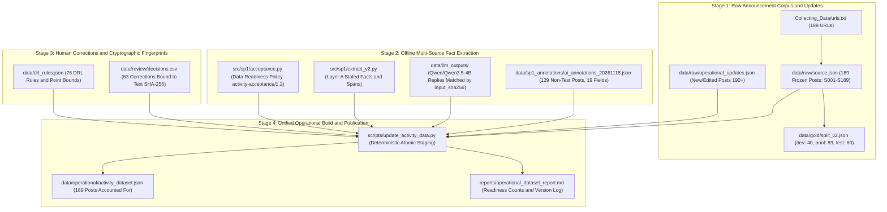
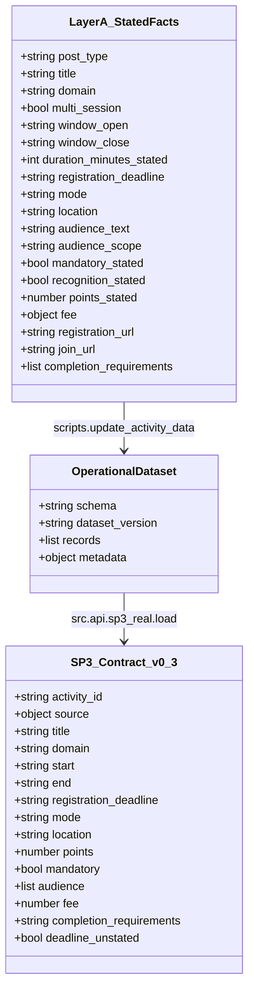

# Data Engineering, Operational Dataset & Governance Architecture

**Scope:** Data collection ([Collecting_Data/](../../Collecting_Data/)), Operational Activity Dataset ([data/operational/activity_dataset.json](../../data/operational/activity_dataset.json)), Schema & ADR Contracts ([schemas/](../../schemas/), [docs/adr/](../../docs/adr/)), Data Readiness Policy ([data/config/activity_acceptance_v1.json](../../data/config/activity_acceptance_v1.json)), DRL Regulation Catalog ([data/drl_rules.json](../../data/drl_rules.json)), and AI-Assisted Annotations ([data/sp1_annotations/](../../data/sp1_annotations/)).

---

## 1. End-to-End Data Lineage & Pipeline Topology (ADR-0003)

A core architectural principle of UniLife is that **the production web server never calls an LLM to extract announcements at runtime**. Per **ADR-0003** ([docs/adr/0003-operational-activity-dataset.md](../../docs/adr/0003-operational-activity-dataset.md)), all announcements are processed through an **Offline Batch Toolchain** into a single authoritative runtime file: `data/operational/activity_dataset.json` (schema `unilife-operational-dataset/1.0`).

Legacy runtime ingestion (`live_ingest.py`, `handover.py`) and intermediate stores (`activity_store_v2.json`, `data/handover/`) have been completely retired.

---

## 2. Operational Dataset Accounting (`N = 189`) & Acceptance Policy 1.2

The real announcement corpus (`data/raw/source.json`) comprises **189 Facebook posts** (`S001`–`S189`) collected across VNU-HCMUS channels. Per ADR-0003, every post is explicitly accounted for in [data/operational/activity_dataset.json](../../data/operational/activity_dataset.json) (`unilife-operational-dataset/1.0`):

### 2.1 Extraction Source Order & Readiness Funnel

1. **Extraction Source Priority:** AI-assisted annotation (`data/sp1_annotations/ai_annotations_20261118.json` for 129 non-test posts) $\to$ recorded Qwen model reply with matching prompt digest (`data/llm_outputs/`) $\to$ deterministic regex rules (`extract_v2.py`) $\to$ `EXTRACTION_PENDING`.
2. **Human Corrections:** Applied last via `data/review/decisions.csv` (63 applied overrides bound to text SHA-256).
3. **Data Readiness Policy (`activity-acceptance/1.2`):** Missing organizer facts (e.g. unknown fee, unstated deadline) stay unknown rather than inventing defaults:
   - **Nullable Fee:** Under SP3 contract revision 0.3 (`sp3-activity/0.3`), fee is nullable (`fee: null`). Unknown fee activities are excluded only from budgets with a strict spending ceiling.
   - **Unstated Deadline:** If an announcement states no registration deadline, it is flagged with `deadline_unstated_by_activity` and accepted by the planner rather than gate-blocked.

| Status / Pipeline Gate | Path / Policy | Record Count | Policy Role & Behavior |
| :--- | :--- | :---: | :--- |
| **1. Frozen Operational Corpus** | `data/raw/source.json` | **189** | 100% of posts accounted for; immutable evaluation corpus |
| **2. AI-Assisted Annotations** | `data/sp1_annotations/` | **129** | 19 stated facts + activity type, evidence spans, provenance |
| **3. Held-Out Test Posts** | `data/gold/split_v2.json` | **60** | Evaluated under logged access trail (`final_run_access_log.jsonl`) |
| **4. Human-in-the-Loop Decisions** | `data/review/decisions.csv` | **63** | Genuine corrections bound to text SHA-256 fingerprint |
| **5. Operational Dataset Records** | `data/operational/activity_dataset.json` | **189** | Single authoritative runtime deliverable for SP2 and SP3 |

### 2.2 Anti-Leakage Corpus Partitioning ([data/gold/split_v2.json](../../data/gold/split_v2.json))

To prevent overfitting regex rules or merge policies to the evaluation set, the 189 posts are deterministically partitioned by [scripts/make_split_v2.py](../../scripts/make_split_v2.py) into three disjoint strata:
- **`dev` ($40$ posts, including 21 gold-annotated posts in `dev_gold21.jsonl`):** Used for rule development, LLM prompt tuning, and automatic selection of `data/config/merge_policy.json`.
- **`pool` (`non_test` extra, $89$ posts):** Combined with `dev` ($129$ non-test posts total) for synthetic duplicate evaluation and pre-test readiness audits.
- **`test` ($60$ held-out posts):** Strictly isolated during development; access during the final batch build is logged to an append-only audit trail ([data/gold/final_run_access_log.jsonl](../../data/gold/final_run_access_log.jsonl)).

---

## 3. Schema Architecture: Layer A vs. Operational Dataset vs. SP3 Contract (v0.3)

Per **ADR-0001**, **ADR-0002**, and **ADR-0003**, activity data progresses through three strictly validated schema layers:

### Key Projection & Provenance Rules ([src/sp1/operational.py](../../src/sp1/operational.py))

Under **ADR-0003** and the unified operational builder ([scripts/update_activity_data.py](../../scripts/update_activity_data.py)), activity records are mapped to the plannable dataset using explicit, audited conventions:

| Target Field | Source in Stated Facts | Acceptance & Projection Convention | Provenance & Evidence Tracking |
| :--- | :--- | :--- | :--- |
| `activity_id` | `source.post_id` | Canonical Facebook `post_id` used for cross-module join consistency | Recorded in `source.post_id` |
| `start` / `end` | `window_open` / `window_close` | If `end` is null and `start` has explicit time + duration, `end = start + duration` | Derived duration recorded in metadata |
| `registration_deadline` | `registration_deadline` | If unstated, flagged as `deadline_unstated_by_activity`; accepted by planner under contract v0.3 | Provenance preserved; never gate-blocked |
| `mandatory` | `mandatory_stated` | Defaults to `false` when unstated | `team_default:false_when_not_stated` |
| `fee` | `fee.amount_vnd` | Nullable under contract v0.3 (`null` if unstated); excluded only from strict budget caps | Preserves `fee_unstated` distinction |
| `completion_requirements` | `completion_requirements` | Serialized string; if empty, marked as `"NOT_STATED"` — never assumed | `team_convention:not_stated` |
| `location` | `location` | Set to `null` when `mode == "online"` per contract invariant | Physical campus preserved in `campus` |

---

## 4. Human-in-the-Loop Adjudication & Cryptographic Stale-Review Detection

In [data/review/decisions.csv](../../data/review/decisions.csv) (63 reviewed records), human corrections are bound to the raw announcement text via a **16-hex-character SHA-256 fingerprint**:

$$\mathrm{fp}(d) = \mathrm{SHA256}\!\left(\mathrm{UTF8}(d.\text{raw\_content})\right)[0:16]$$

When `apply_decision(record, decision, raw_content)` executes during `update_activity_data.py`:
1. If `decision.text_sha256 != fp(raw_content)`, the review decision is marked **`stale = True`** and **ignored**, ensuring an old human override is never silently applied to an updated announcement text.
2. Otherwise, verified reviewer overrides (`post_type`, `activity_type`, `mode`, `domain`, `title`, `window_open`, `window_close`, `registration_deadline`, `location`, `fee_amount_vnd`, `reviewer_rule_id`) supersede automated extraction and clear the corresponding `needs_review:<field>` flags, recording `"method": "human_review"` in `meta.evidence`.

---

## 5. SP2 Rule Catalog & Two-Source Binding Governance

### 5.1 Structure of [data/drl_rules.json](../../data/drl_rules.json)
The regulation file encodes **76 rules** across the 5 official HCMUS categories (`C1`..`C5`) under Decision `1028/QĐ-KHTN-CTSV` and `STSV2025`:
- **75 Verified Rules (`"status": "verified"`):** Active in SP2 scoring (`evaluate_rule_conditions` and `evaluate_progress`).
- **1 Quarantined Rule (`R23`, `"status": "needs_review"`):** Quarantined during the Regulation Source Audit ([docs/REGULATION_SOURCE_AUDIT_20261027.md](../../docs/REGULATION_SOURCE_AUDIT_20261027.md)) because Section 2.2 of the appendix had no independent basis for `R23`; automatically skipped by `drl_engine.py`.
- **Default-Awarded Baseline Rules (`"default_awarded": true`):** Compliance rules granted at the start of a semester unless a violation is recorded, producing an authentic opening baseline score (65 points) without hardcoded magic numbers.

### 5.2 Dual-Source Agreement Policy for SP3 Score Bindings ([src/sp2/binding.py](../../src/sp2/binding.py))
To bind plannable activities to SP2 rules in [data/operational/activity_dataset.json](../../data/operational/activity_dataset.json), `propose_binding` enforces the `agree_else_review` policy:
- **Auto-Proposed Bindings (`129 / 174` activities):** Emitted **only** when (1) SP1's `activity_type` maps to an allowed rule set in `TYPE_RULES` and (2) SP2's `match_activity_to_rule` independently predicts a `rule_id` inside that exact allowed set.
- **Human-Reviewed Bindings (`33 / 174` activities):** Bound via explicit `reviewer_rule_id` in `data/review/decisions.csv` (`binding_ref: "reviewed-<rule_id>-<post_id>"`).
- **Unbound / Needs-Review Activities (`12 / 174` activities):** Left unbound (`score_binding_ref = null`), causing SP3 `assess_feasibility` to classify them as `NEEDS_REVIEW` (`MISSING_SCORE_BINDING`) so they are never speculatively scheduled.

---

## 6. Statistical Quality & Prompt-Injection Red-Team Evaluation

### 6.1 Extraction Accuracy & Plannability (95% Wilson Confidence Intervals)
Using the Wilson score interval for binomial proportions $p = k/n$ at $z_{0.975} = 1.95996$:

$$\mathrm{CI}_{95\%}(k, n) = \frac{k + \frac{z^2}{2} \pm z \sqrt{\frac{k(n-k)}{n} + \frac{z^2}{4}}}{n + z^2}$$

- **Field-Level Gold V1 Accuracy ($n = 160$ decidable fields across 16 posts):**
  - Rules-only: $126 / 160 = 78.8\%$ ($95\%\text{ CI}: [71.8\%, 84.4\%]$), $4$ fabricated.
  - LLM-only (`Qwen/Qwen3.5-4B`): $123 / 160 = 76.9\%$ ($95\%\text{ CI}: [69.8\%, 82.7\%]$), $5$ fabricated.
  - **Hybrid V2 (`merge_policy.json`):** **$130 / 160 = 81.3\%$** (**$95\%\text{ CI}: [74.5\%, 86.5\%]$**), reducing fabricated fields by **$50\%$** (down to $2$).
- **Field-Level Gold V2 Accuracy ($n = 95$ fields across 5 posts):**
  - **Hybrid V2:** **$84 / 95 = 88.4\%$** (**$95\%\text{ CI}: [80.4\%, 93.4\%]$**).

### 6.2 Prompt-Injection Red-Team Evaluation ([reports/sp1_redteam_eval.md](../../reports/sp1_redteam_eval.md))
Evaluated across **25 adversarial prompt-injection attacks** (`redteam_v1`: 13 attacks + 3 benign controls; `redteam_v2_heldout`: 12 held-out attacks + 3 benign controls, including delimiter breaks, zero-width obfuscation, base64 payloads, Chinese instructions, and persona overrides):
- **Red-Team V1:** $13 / 13$ ($100\%$) attacks detected and flagged with `injection_suspected` (`status = failed`, routed to review queue); **$0 / 13$ ($0\%$) harmful leaks** reaching the planner.
- **Red-Team V2 (Held-Out Obfuscated Attacks):** Because `llm_v2.py` enforces the **Zero-Fabrication Value Grounding Invariant (Proposition 1.2)** and `merge_policy.json` retains `rules` on `points`, `fee`, and `mandatory`, **$11 / 12$ ($91.7\%$) held-out attacks kept all expected values intact**, with only $1 / 12$ (`rt2-09`, which forged a realistic Vietnamese body line `"Hình thức: trực tuyến"`) altering the `mode` field.
