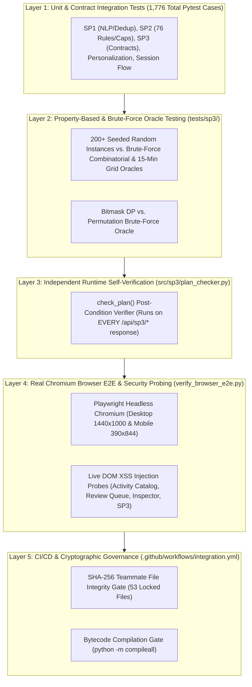
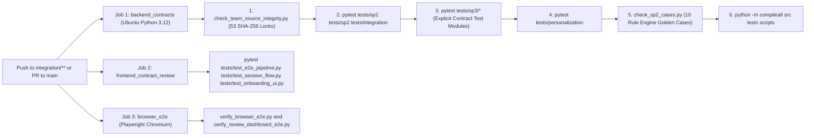

# Testing, Runtime Verification & CI/CD Quality Engineering

**Scope:** Automated Test Suites ([tests/](../../tests/) — 1,776 collected tests), Independent Runtime Plan Verifier ([src/sp3/plan_checker.py](../../src/sp3/plan_checker.py)), Seeded Property-Based Oracle Testing ([tests/sp3/test_planner_properties.py](../../tests/sp3/test_planner_properties.py)), Real Chromium Browser E2E & XSS Security Probing ([scripts/verify_browser_e2e.py](../../scripts/verify_browser_e2e.py)), and GitHub Actions CI Pipeline ([.github/workflows/integration.yml](../../.github/workflows/integration.yml)).

---

## 1. Multi-Layer Quality Assurance Pyramid

Because UniLife integrates contributions from six team members across NLP extraction, regulation scoring, combinatorial scheduling, and a Single-Page Application, quality assurance is enforced through **five defensive layers**:

---

## 2. Independent Runtime Plan Verifier ([src/sp3/plan_checker.py](../../src/sp3/plan_checker.py))

A standout software engineering practice in UniLife is **Design-by-Contract Runtime Verification**. Rather than trusting `sp3.planner.build_plan` and `sp3.scheduler.schedule_set` only during offline unit tests, every production API call to `/api/sp3/demo/plan` and `/api/sp3/personalized/plan` ([src/api/sp3_service.py:163](../../src/api/sp3_service.py#L163), [src/api/sp3_real.py:222](../../src/api/sp3_real.py#L222)) passes its output through an independent verifier `check_plan(planner_input, plan, score_callback, input_snapshot=snapshot)` **before** returning to the frontend.

### Architectural Independence
`plan_checker.py` (724 lines) **deliberately does not import `planner.py` or `scheduler.py`**. It shares only data types from `contract.py` and re-verifies every obligation from scratch:

| Verification Category | Violation Codes Checked | How `check_plan()` Independently Verifies It |
| :--- | :--- | :--- |
| **Input Immutability & Envelope** | `INPUT_MUTATED`, `OUTPUT_SHAPE`, `ENVELOPE_MISMATCH`, `DEMO_FLAG` | Compares `planner_input` against a pre-planning deep copy `input_snapshot`; verifies `mode == "DEMO_ONLY"` and `official_award_verified is False`. |
| **Candidate Coverage** | `CANDIDATE_COVERAGE`, `UNEXPECTED_ERRORS` | Asserts that `selected_activities` and `excluded_candidates` form an exact disjoint partition of all input candidates (every candidate appears exactly once). |
| **Schedule Validity & Non-Overlap** | `SELECTED_NOT_ELIGIBLE`, `SELECTED_BLOCKS`, `SELECTED_OVERLAP`, `SELECTED_CONFLICT`, `LIMIT_VIOLATED`, `KEEP_NOT_HONORED` | Sorts all scheduled blocks across all selected activities and checks pairwise non-overlap, containment inside `available_intervals`, adherence to `max_activities` and `max_duration_minutes`, and preservation of `keep_requests`. |
| **Independent Re-Scoring** | `RESCORE_FAILED`, `SCORE_SUMMARY_MISMATCH`, `REASON_MISMATCH`, `SCORE_COMPARISON` | Calls the SP2 scorer callback independently on `selected_ids` (and on `previous_activity_ids` for replans) and verifies `projected_by_category`, `gain_by_category`, `remaining_by_category`, and per-activity `GOAL_CONTRIBUTION` reasons within tolerance $10^{-9}$. |
| **Brute-Force Schedulability & Completeness** | `EXCLUSION_CODE`, `SEARCH_COUNT`, `UNPROVEN_UNREACHABLE`, `SEARCH_OVERCLAIM` | For sets with $\le 6$ flexible activities (`BRUTE_FORCE_FLEXIBLE = 6`), tests all $k!$ permutations (`itertools.permutations`) to independently verify `NO_TIME` exclusions, complete search counts, and `PROVEN_UNREACHABLE` certificates. |

If `check_plan` returns any `Violation`, the API immediately raises a `RuntimeError` rather than serving an invalid schedule to the student.

---

## 3. Property-Based Testing Against Brute-Force Oracles

To verify that the optimizations in `scheduler.py` (Bitmask DP `_place` and `_keep_most`) and `planner.py` (Antimatroid pruning and Cardinality Dominance early stopping) never miss a valid schedule or return a suboptimal plan, the test suite includes seeded **Property-Based Oracle Tests** ([tests/sp3/test_planner_properties.py](../../tests/sp3/test_planner_properties.py), [tests/sp3/test_scheduler_properties.py](../../tests/sp3/test_scheduler_properties.py)):

1. **Fixed-Schedule Combinatorial Oracle (`test_planner_matches_oracle_and_passes_checker`, 100 random seeds):**
   - Generates random activity catalogs with random category caps, baseline scores, targets, domain/mode preferences, duration limits, and conflict graphs.
   - Compares `build_plan()` against a 20-line brute-force `oracle_best()` that enumerates all $2^N$ subsets using `itertools.combinations`.
   - Asserts that:
     - `build_plan` achieves the exact same 8-tuple rank as `oracle_best`.
     - `evaluated_subsets <= valid_count` (verifying that dominance pruning saves work without losing optimality).
     - Shuffling the input candidate list and conflict pairs produces the **exact same JSON output** (100% determinism).
2. **Mixed Fixed/Flexible 15-Minute Grid Replan Oracle (`test_replan_planner_matches_grid_oracle_and_passes_checker`, 100 random seeds):**
   - Quantizes a 6-hour window (`08:00–14:00`) into 24 discrete 15-minute slots (`GRID_SLOTS = 24`) with random busy cells, mixed `FIXED` and `FLEXIBLE` activities, random `previous_plan` placements, and random `keep_requests`.
   - Compares `build_plan()` against an exhaustive grid oracle `grid_min_changes()` that tries every possible 15-minute slot placement of every flexible activity to find the true minimum `time_changes`.
   - Verifies that `build_plan` matches the grid oracle on both the optimal activity subset and the exact minimum number of moved activities (`MOVED`).
3. **High-Performance SP3 Combinatorial Optimization Suite ([tests/sp3_optimization/](../../tests/sp3_optimization/)):**
   - **`test_planner_opt.py` (Guided Search v2 Verification):** Proves that Guided Search v2 matches exact branch-and-bound on small/medium scenarios, eliminates the multi-category cap blindspot, preserves plan stability on replans, optimizes `PREFERENCE_FIRST` utility, and adheres strictly to evaluation budget bounds.
   - **`test_scheduler_opt.py` (Fast v2 Available-EDF Verification):** Proves that Fast v2 matches Exact Bitmask DP on tight instances, scales cleanly to 64 flexible activities ($1.1\text{ ms}$), resolves the Earliest Completion Time (ECT) trap, and preserves soundness by returning `UNDETERMINED` rather than falsely claiming `UNSCHEDULABLE` on heuristic failure.

---

## 4. Real Chromium Browser E2E, Review Dashboard & Security Probing

Unlike mock DOM tests (such as jsdom), the testing harness executes comprehensive browser verification using real headless Playwright Chromium and runtime Node.js scripts:

1. **PBKDF2 Account Registration, Onboarding Wizard & 5 E2E Cases ([scripts/verify_browser_e2e.py](../../scripts/verify_browser_e2e.py), [tests/test_onboarding_ui.py](../../tests/test_onboarding_ui.py)):**
   - Exercises the 5-step onboarding wizard, 15-minute drag calendar, profile reconciliation, and verifies `5/5 PASS` across the 5 canonical intake scenarios.
2. **Review Dashboard Runtime & Real-Time Countdown Clock ([scripts/verify_review_dashboard_e2e.py](../../scripts/verify_review_dashboard_e2e.py), [tests/review_dashboard_runtime.cjs](../../tests/review_dashboard_runtime.cjs)):**
   - Verifies the live countdown clock to activity registration deadlines (`test_review_dashboard_clock.py`), ensuring timers tick without memory leaks or race conditions.
   - Tests the 1-click Swap Preview modal, verifying that clicking "Đổi hoạt động" queries `/api/sp3/personalized/swap-preview`, displays score impact, and commits cleanly upon user confirmation.
3. **Operational Browser Path Verification ([scripts/verify_operational_browser.py](../../scripts/verify_operational_browser.py)):**
   - Validates that the operational dataset (`data/operational/activity_dataset.json`, 189 posts accounted for) loads seamlessly in the browser UI without broken images, undefined labels, or missing point estimates.
4. **Live DOM Cross-Site Scripting (XSS) Injection Probes:**
   - Intercepts `/api/activities` and `/api/sp3/catalog` responses and injects malicious HTML payloads (``) into activity titles, publisher names, locations, review queue flags, SP1 inspector evidence spans, and SP3 selected activity titles.
   - Asserts that `window.__h4_xss === 0` and zero `` tags are created in the DOM, proving that `escapeHTML()` neutralizes untrusted social media content across every view.

---

## 5. CI/CD Pipeline & Cryptographic Source Lock ([.github/workflows/integration.yml](../../.github/workflows/integration.yml))

The GitHub Actions workflow runs three parallel jobs on every push to `integration/**` and every pull request targeting `main`:

### Key CI Governance Mechanisms
1. **Cryptographic Teammate File Lock ([scripts/check_team_source_integrity.py](../../scripts/check_team_source_integrity.py) & [docs/TEAM_SOURCE_LOCK_20261029.json](../../docs/TEAM_SOURCE_LOCK_20261029.json)):**
   - Verifies the exact SHA-256 digest of **53 protected team files** (after CRLF-to-LF normalization).
   - **Real-World Case Study (Commit `8b3b1fb`):** When student scoreboard offsets were initially prototyped inside `src/sp2/drl_engine.py`, the CI integrity check detected the modification. To preserve the 53-file lock, the team refactored the logic out of `drl_engine.py` into an external wrapper `_apply_category_offsets` in `src/api/plan_completion.py`, successfully maintaining 100% SHA checksum compliance.
2. **Comprehensive E2E Dashboard Runtime Checks:**
   - Incorporates `review_dashboard_runtime.cjs` to validate state synchronization between the SP3 planner, confirmed plans, and client-side countdown clocks.
3. **Automated Visual Evidence Archival:**
   - The `browser_e2e` job uploads full-page Chromium acceptance screenshots and `evidence.json` as downloadable GitHub Actions artifacts.
